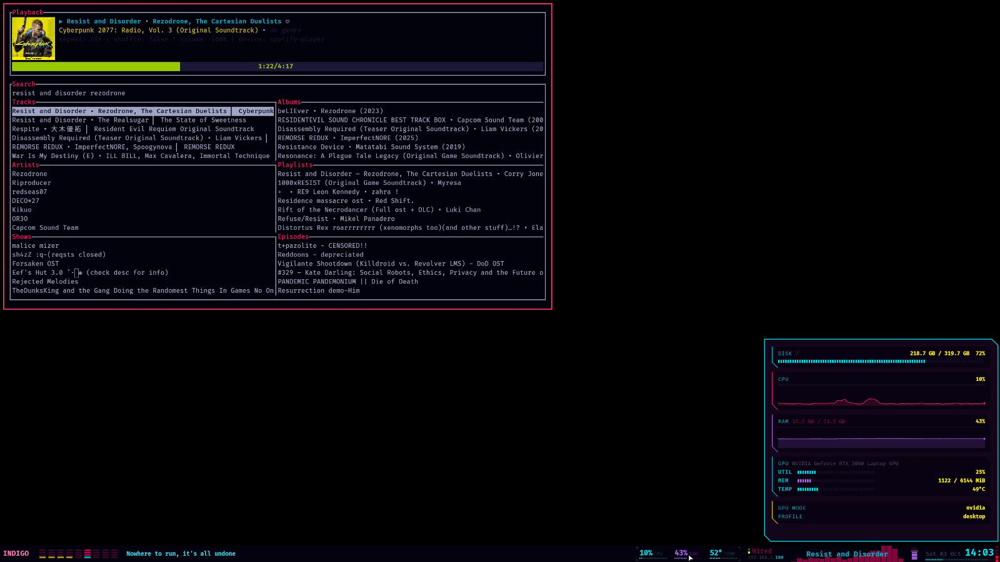
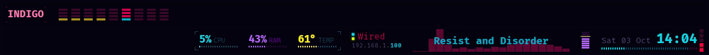
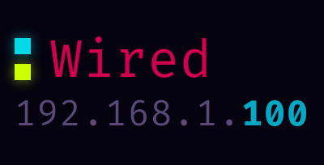
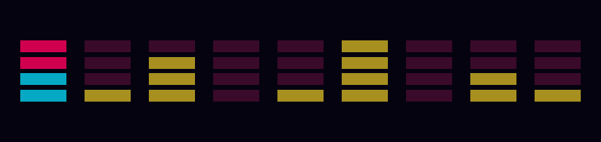
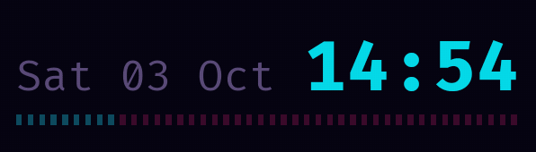
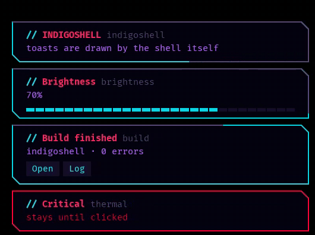

# indigoshell

A widget-engine desktop shell for X11. One Python process draws a bar,
its panels, its chord menus, its app launcher, its notification toasts,
its system tray and a call overlay to an agent on another machine — all
on a single asyncio loop, with no toolkit, no second main loop and no
worker threads. Beside it in this checkout is Flux, the shell's own web
browser, a process of its own on PySide6 and QtWebEngine.

<p align="center">
  
</p>

```
xcffib      windows, input, seat grabs, struts, ARGB visuals, RandR
skia        all rendering; SkSL shaders for the post-process effects
dbus-fast   notification daemon, StatusNotifierItem tray, MPRIS, dbusmenu
asyncio     X events, IPC, D-Bus, subprocesses and frame clocks, one loop
```

Styled out of the box with the INDIGO Cyberpunk palette: hot magenta,
electric cyan, neon yellow, violet accent, deep blue-violet base.

## Agent — Claude on the line

`MOD+A` calls the agent. A call overlay drops into the top-right corner,
takes the keyboard, and on the other end is an agent that lives on a
**hub**, a machine of its own (the author's is a Raspberry Pi). It
answers in a few lines, and while it works it can reach into this
machine: the shell lends it *hands*, tools it runs here — a shell,
files, screenshots, windows, the clipboard and the browser.

<p align="center">
  
</p>

The hub is a separate project, not in this repository: what is here is
the shell's side of the call. It talks to the hub over a WebSocket with
mutual TLS ([`agent/remote.py`](indigoshell/agent/remote.py)), and with
no hub to talk to there is no call — the shipped config has none until
a `config.py` adds it (below). On the hub the agent is Claude, run
through Claude Code: one mind with two voices, Indigo and Lilac, and
one conversation shared with the other devices connected to it.

- **A call, not a chat window.** Your plate on top, the agent's below,
  each with its chip. What it *does* shows as one-line steps, kept apart
  from what it *says*; click a step for the whole command and its
  output. Replies render Markdown with clickable links, and any of it
  can be selected and copied.
- **Two voices.** `Ctrl+S` switches who answers your next line, Indigo
  or Lilac, and the call remembers the pick. The turn on show may be in
  the other voice — asked from another device, or before a switch — and
  the agent's plate and chip take that voice's name and colour, which
  are the hub's.
- **Chips you read at a glance.** Arcs turning: working. Blinking: it
  wants you — an answer blinks twice, a question blinks until answered.
  While a turn runs, the agent's frame is redrawn clockwise as a turn
  clock, one lap a minute.
- **Model and effort on its header.** `Ctrl+M` switches the model on
  the live conversation and `Ctrl+T` the effort; the hub keeps the real
  settings. The header names the model as the hub reports it —
  `opus 5.5`, never a guess — and the effort by street name: idle,
  stock, boost, overclock, redline (low to max).
- **Talk over it.** A line sent while it works goes in at once and
  shows in its plate, in your colour, where you sent it; the agent reads
  it at its next step and folds it into the task. `Ctrl+C` stops it now
  instead. A line said while the hub is out of reach waits, and goes
  when the line is back.
- **It hangs up on long jobs and calls back.** For anything slow it
  says what it's about to do and hangs up. The agent's chip at the
  right end of the top bar keeps naming the step it is on while its arcs
  turn, and when the work is done it turns red and blinks until you
  answer: a click opens the call, a right-click silences it, and a ring
  seen on another screen stops here too. Escape hangs up from your
  side — the work carries on either way.
- **It asks before going root.** A command or background job it runs
  here that mentions `sudo`, `doas`, `pkexec`, `su` or `run0` stops and
  asks on the call — click GREENLIGHT or SCRUB (or press `A` / `D`),
  every time; no answer before the hub gives up is a no. Commands that
  weren't allowed run with those five shadowed on their PATH, so a
  script that calls one by name is refused rather than let through. The
  hub's own questions ask the same way.

  

- **This machine's hands.** What the laptop lends (`laptop_hands()`,
  [`agent/laptop.py`](indigoshell/agent/laptop.py)): opening a link or
  a file in its usual program, brought forward on its workspace;
  screenshots of the screen, one monitor or one window; the workspaces
  and their windows, focusing one, starting an app by name; the
  clipboard, and the text you highlighted last; a shell as you
  (`bash -lc`); background jobs that outlive the call, the line to the
  hub and a reload of the shell, and tell the hub when they end; reading
  and writing files; and its uptime, load, memory and battery. The hub
  gives them to its agent as `<device>_<name>`.
- **Your browser too.** With [Flux](#flux--the-browser) here, the
  laptop also lends Flux's hands ([`flux/hands.py`](flux/hands.py)):
  tabs, pages read as an outline with numbered refs or as an article,
  clicks, typing, forms, file uploads, screenshots of a tab, downloads,
  and JavaScript in the page behind Flux's guard. It acts signed in as
  you, with no question asked; Flux never hands it a password field's
  value and leaves a site's permission prompts to you. While it drives a
  tab, Flux draws its hold in the voice's colour and locks your input
  out; a key from you takes the tab back. What is its to do alone
  happens in a Flux window of its own, on a workspace you aren't looking
  at, where it borrows a tab and returns it when done.
- **Look.** `Ctrl+L` makes your next line carry what you are looking at
  in Flux — the tab, the selection, the picture in it or under the
  pointer — named on a chip over your line. `Ctrl+Shift+L` adds a
  screenshot of the tab. `Ctrl+L` again, or Escape on an empty line,
  takes it off.
- **It shows you things.** A picture the agent shows lands in its
  reply, scaled to the column, its caption under it; a file shows as one
  line, with its name and size. Click one, or press `Ctrl+F` for the
  turn's last, and it is saved to `~/Downloads` and opened in its usual
  program.
- **The hub's devices.** `Ctrl+D` lists them: which are online or when
  each was last seen, their connections, and the hands each lends.
- **A hologram, glitches and all.** The plates and chips share one
  raster on the screen's pixel grid; every few seconds a scan band runs
  down the whole call and the image tears as it passes. Replies decode
  in a chunk at a time as they stream.

| Key | In the call |
|---|---|
| `Return` | send — even while it works: it reads the line at its next step |
| `Esc` | hang up (the work carries on) |
| `Ctrl+C` | copy the selection; with none, stop the task |
| `Ctrl+S` | who answers your next line: Indigo or Lilac |
| `Ctrl+L` · `Ctrl+Shift+L` | Look: your next line carries Flux's tab · and a screenshot of it |
| `Ctrl+F` | open the last picture or file the agent showed |
| `Ctrl+N` · `Ctrl+H` | a new conversation · past ones, to resume |
| `Ctrl+D` | the hub's devices |
| `Ctrl+M` · `Ctrl+T` | next model (opus, sonnet, haiku, fable) · effort (idle … redline) |
| `Ctrl+O` | every step of the turn |
| `A` `D` | greenlight (allow), scrub (deny) |
| `PgUp` `PgDn` | scroll a long reply |

Setting it up takes a hub, the `call` extra — only `websockets` — and
a certificate and key for this machine that the hub accepts. Which hub,
with which certificates, is each machine's to say, so the shipped
config has no call; a `config.py` adds it with `call(hub)`:

```bash
uv pip install 'websockets>=15'
```

```python
# ~/.config/indigoshell/config.py
from indigoshell.agent import RemoteAgent, laptop_hands
from indigoshell.config_default import (MENUS, SCREEN, SERVICES,
                                        STARTUP, WINDOWS, call)

HUB = RemoteAgent(voice="indigo", endpoints=["wss://hub.lan:443"],
                  tls={"ca": ..., "cert": ..., "key": ...},
                  hands=laptop_hands())
CALL, CALL_SERVICES = call(HUB)
WINDOWS = [*WINDOWS, CALL]
SERVICES = [*SERVICES, *CALL_SERVICES]
```

`voice` answers until `Ctrl+S` switches it. `tls` names three PEM
files — the hub's CA, this machine's certificate and its key — and only
that CA is trusted; the hub's certificate must carry the name given as
`server_name`, whatever address answered. `endpoints` are tried in
order, so the home address goes first and a public one after it.
`hands` is what this machine lends; leave it out and it lends none. The
line stays up while the shell runs, so a turn that ends with the call
closed still rings, and it comes back by itself when either machine was
away; until it is up, the call says it can't reach the hub, and why.
Then bind the call:

```python
Key([MOD], "a", lazy.spawn(INDIGOSHELL + ["toggle", "call"])),
```

## Showcase

<p align="center">
  <a href="https://youtu.be/k2VP-eW4FqI">
    
  </a>
  <br>
  <a href="https://youtu.be/k2VP-eW4FqI">▶ indigoshell on qtile — the full tour (YouTube)</a>
</p>

Nothing in the video is played by hand: it was performed by synthetic
input, recorded at 1440p60 and cut by the scripts in
[`prototypes/showcase/`](prototypes/showcase/), and its closing reel is
the bar's own widget classes rendered on the GPU at several times their
size, cut to the song's beats.

## What it does

- **Bar** — a dock window that reserves its own strut, with a
  declarative widget tree (`Row([...])`, `Box`, `Spacer`, `Brackets`).

  

- **Top bar** — a thinner second dock along the top. Its left is the
  focused indigoshell app's section — [Flux](#flux--the-browser)'s tabs,
  a box each, and the page's host while a Flux window has focus, nothing
  while any other window does — and its right end the agent's chip, when
  a call is configured. An app only says what its section holds (the
  [app bar protocol](indigoshell/applink/PROTOCOL.md)); the look, the
  motion and the keys are the shell's. Its inputs turn the section into
  a text box, their suggestions dropping flush under it as if the bar
  grew down; its menus drop the same way, filtered by typing.

- **Widgets** — plain at rest, animated when something happens:
  - **workspaces**, each a stack of bars for its window count, an urgent
    one ringing red;
  - the **INDIGO** tag, breathing slowly;
  - **lyrics** piped from `sptlrx`, each line arriving with a glitch-wipe
    reveal and pulsing on the beat;
  - **CPU / RAM / TEMP** meters framed as one cluster by corner brackets,
    TEMP sweeping cyan → yellow → red;
  - **network**, with two dots that blink with throughput (cyan sent,
    lime received) over the address;
  - **now playing**, the title scrolling over a cava visualiser that
    tints on every beat, with the odd binary glitch;
  - **volume**, a level stack under a yellow cap;
  - the **clock**, with a battery underline that sweeps while charging
    or discharging and shimmers lime when full;
  - the **system tray**.

  <table>
    <tr>
      <td align="center"><br><sub>now playing</sub></td>
      <td align="center"><br><sub>lyrics</sub></td>
    </tr>
    <tr>
      <td align="center"><br><sub>meters</sub></td>
      <td align="center"><br><sub>network</sub></td>
    </tr>
    <tr>
      <td align="center"><br><sub>workspaces</sub></td>
      <td align="center"><br><sub>clock + battery</sub></td>
    </tr>
  </table>

- **Panels** — `system` (fastfetch), `hardware` (CPU/RAM history, live
  GPU readouts), `network` (interfaces, wifi, firewall, a streamed
  `speedtest-cli` run). Anchored to a screen edge, dismissed by clicking
  outside — and by Escape where the window takes a keyboard grab — and
  kept alive between opens, so a keybind shows one in the time a close
  would take.

  

- **Chord menus** — a keybind opens a stack of chips at the bottom
  right; a digit picks, Escape backs out. Shipped: power, display,
  layout, profile, audio, graphics. An action that returns another
  `Menu` becomes the next stage in the same window, so multi-step flows
  are just functions returning menus.

  

- **Launcher** — replaces rofi's `drun`: a centred panel over every
  installed desktop entry, with their theme icons, fuzzy matching (fzy's
  scorer, case- and accent-blind, matched letters lit) and launch
  history that lifts the apps actually used. Type straight away — keys
  pressed during the spawn animation are kept. Shift+Return runs the
  query as a command line. Apps start in their own systemd scope,
  detached from the shell, so a reload never takes them down. Inside it
  is the top bar's input (Flux's address box), fed by the app catalog.

  

- **Notifications** — a full `org.freedesktop.Notifications` daemon,
  replacing dunst. One window per toast, so the spawn and despawn
  animations play per notification; urgency styling, images, action
  chips, replace-by-id, and a segmented meter when a `value` hint
  arrives. The border traces the remaining time; hovering any toast
  pauses them all; a critical one stays until clicked.

  

- **System tray** — registers as `org.kde.StatusNotifierWatcher` and
  Host. Compatible with `nm-applet --indicator`, `blueman-applet`,
  `udiskie --tray`, Discord, Steam. Right-click opens the app's own
  menu, walked over `com.canonical.dbusmenu` and drawn as our own rows.

  

- **GPU effects** — every window can run a chain of SkSL post-process
  passes over its finished frame. Panels open with `ScanLock`, a
  scan-lock reveal where bands snap in out of order with a sideways tear
  and an RGB split, and then carry the call's hologram: a faint raster,
  and a scan band that glitches down them every few seconds. Rendering goes through an EGL/GL surface when one
  can be created and falls back to CPU raster when it can't.

  

- **Damage-driven repaint** — a window only paints the rectangles that
  changed, and only wakes at the highest `animation_fps` any visible
  widget asks for. A still bar costs nothing.
- **Hot reload** — `--watch` re-execs on `.py` change, or
  `indigoshell reload` over the control socket.

## Flux — the browser

Flux is the shell's own web browser: a program of its own beside the
shell in this checkout ([`flux/`](flux/)), on PySide6 and QtWebEngine
(Chromium). One window holds many pages as tabs, and there is one Flux
per profile: a second invocation hands its URLs to the running one.

```bash
indigoshell browser [url ...]   # or from the checkout: python -m flux [url ...]
indigoshell browser --install   # its entry in the launcher, "Flux"
```

It is an indigoshell app, the first: each window sends the shell its
section of the top bar over `applink/`, the shell's line to its own
apps ([the app bar protocol](indigoshell/applink/PROTOCOL.md);
[`flux/bar.py`](flux/bar.py) makes Flux's of a window's state), and
nothing of Flux's is in the shell. While a Flux window has focus the
top bar shows its tabs (click, middle-click to close, drag to move or
off the bar to tear out), the page's host, and its inputs and menu:
`Ctrl+L` the address and `Ctrl+T` a new tab's, answered from Flux's
history and bookmarks as you type (`Shift+Delete` takes a bookmark
out), `Ctrl+F` find (type, Enter, then `n` / `N` step: the page never
sees those keys), `Ctrl+M` the bookmark actions. Either side can start,
stop or restart at any time. With no shell Flux writes the same into a
line at its window's top, asks for addresses with a dialog of its own
and finds over the page itself, so it is usable alone.

Its own keys: `Alt+1`…`Alt+9` go to a tab and `Alt+Shift+1`…`9` move
the current one there, `Ctrl+W` closes a tab and `Ctrl+Shift+T` reopens
the one closed last, `F12` opens the inspector.

`--profile NAME` runs a Flux of its own beside the default one, with
its own storage, history, bookmarks and socket; `--headless` runs one
with no screen, for a machine with no display. Its single-instance
socket is also its control socket, which is how the agent drives it
(above). Flux imports only the shell's pure modules
([`tests/flux_imports.py`](tests/flux_imports.py) checks it), so it
needs none of the shell's own dependencies — only PySide6 with
QtWebEngine, from the distro ([Dependencies](#dependencies)).

## Architecture

```text
indigoshell/
  app.py            ─ entry point: client mode vs daemon mode, config load
  api.py            ─ open/close/toggle handlers for config files
  window.py         ─ WindowSpec + the live window: layers, anchors,
                      struts, grabs, frame clock, damage, effect chain
  theme.py          ─ palette, semantic tokens, per-widget presets
  shapes.py         ─ the beveled rectangle, as a skia.Path
  text.py           ─ font cache, measurement, tracked drawing
  fuzzy.py          ─ fzy's scorer with match positions, accent folding
  effects.py        ─ Effect base + ScanLock, Decode, GlitchWipe,
                      Aberration, ColorSplit (SkSL)
  plugin.py         ─ plugin contract: Menu, Item
  markdown.py       ─ Markdown to plain text + spans, for mono-grid wrapping
  config_default.py ─ the shipped bars, panels, menus and services; call(hub)
  agent/            ─ the call: the shell's side of the agent on a hub
                      (see Agent, above)
    remote.py       ─ RemoteAgent: the line to the hub (WebSocket, mutual
                      TLS), turns, questions, ring-backs, voices, history
    activity.py     ─ the agent's steps and questions, as the call shows them
    hands.py        ─ Hands: the tools this machine lends, and their calls
    laptop.py       ─ the desktop as those tools: open, screenshot, windows,
                      apps, clipboard, shell, background jobs, files
    desk.py         ─ what those and the call share: running a program,
                      the window manager, opening a link or a file on its
                      workspace
    progress.py     ─ long commands' progress, over a datagram socket (the
                      call draws the bars; nothing on the hub reports yet)
    watch.py        ─ the reporting end; the yt-dlp/ffmpeg/curl/rsync wrapper
    ui/             ─ call.py (keys, layout), agent_plate.py, you_plate.py,
                      choice.py (GREENLIGHT / SCRUB), bars.py (progress),
                      chip.py, status.py (the top bar's AgentChip), frame.py
                      (turn clock), reveal.py (decode), media.py (pictures
                      and files shown), rows.py, style.py
  applink/          ─ the shell's line to its own apps, and the top bar they set
    PROTOCOL.md     ─ the app bar protocol: what an app sends, what comes back
    bar.py          ─ its vocabulary: names, builders, the shape checks (pure)
    protocol.py     ─ one unix socket, one JSON object per line (pure)
    service.py      ─ AppService: who is connected, who has focus, their
                      bars, the keys taken, the input or menu open
    context.py      ─ the top bar's area for the focused app
    view.py         ─ BarView: an app's section, its items kept by id
    kinds/          ─ the items' look and mouse: tabs, text, button; the
                      open input's box; the shared look (colour roles, icons)
    prompt.py       ─ an open input or menu: queries, keys, steps, actions
    drop.py         ─ the drop-down under the bar: the rows, unrolling
    catalog.py      ─ the app catalog as an input's rows
    launcher.py     ─ MOD+D's launcher: that input framed as a centred panel
  wm/               ─ the window manager and display server outside the core:
                      workspaces and windows, screenshots, clipboard, outputs,
                      keyboard layouts, logging out; niri if $NIRI_SOCKET is set
    x11.py          ─ X11 + qtile: qtile cmd-obj, EWMH, xclip, import, xrandr
    niri.py         ─ niri over its IPC socket (event stream for the bar)
    wayland.py      ─ wl-clipboard, and screenshots over wlr-screencopy
    tiling.py       ─ for niri: qtile's two columns (python3 -m
                      indigoshell.wm.tiling, standard library only)
  backend/
    x11.py          ─ the process's single xcffib connection + event pump
    gl.py           ─ EGL/GL surfaces for Skia, with a raster fallback
  core/
    daemon.py       ─ the loop: windows, services, IPC, signals, reload
    ipc.py          ─ control socket (line-delimited JSON over AF_UNIX)
    client.py       ─ the CLI side of that socket
    hands.py        ─ what a tool lent to the hub's agent is (pure; Flux's too)
    voices.py       ─ the agent's voices: names and colours (pure; Flux's too)
    registry.py     ─ plugin discovery, shipped then user, later winning
    naming.py       ─ APP / CLI / env prefix, derived from the package
    paths.py        ─ socket, lock, config, state and log locations
    state.py        ─ small JSON file for choices that outlive a run
    singleton.py    ─ the lock that keeps one daemon per session
    log.py          ─ colored stderr, optional rotating file
  plugins/          ─ shipped chord menus
    system.py       ─ power, keyboard layout, tuned profile, GPU mode
    audio.py        ─ default sink / source, two stages
    display.py      ─ pick an output; remembers and restores it
  services/         ─ non-drawing, subscribe-based brokers
    bus.py          ─ the one shared D-Bus session connection
    notifications.py─ org.freedesktop.Notifications server
    systray.py      ─ StatusNotifierWatcher + Host
    dbusmenu.py     ─ com.canonical.dbusmenu client
    music.py        ─ playerctl --follow status broker
    beat.py         ─ cava bands + aubio beat detection, both lazy
    sysinfo.py      ─ 1Hz CPU/RAM sampler, direct-sysfs temperature
    apps.py         ─ installed-app catalog, ranked search, launch history
    desktop_entry.py─ .desktop parsing, visibility, Exec -> argv
    icons.py        ─ icon theme lookup (indexed once) and loading
    proc.py         ─ run / fire / launch / subscribe, all coroutines
    clipboard.py    ─ copy to CLIPBOARD / PRIMARY (xclip, or wl-copy on niri)
    text_effects.py ─ scramble and other arrival animations
  widgets/          ─ measure / arrange / paint / hit, and nothing else
    base.py           layout.py    label.py     panel.py    tabs.py
    workspaces.py     systag.py    clock.py     volume.py   network.py
    media.py          meters.py    hud.py       menu.py     systray.py
    notification.py   line_graph.py stdout_text.py
    hardware_panel.py network_panel.py fastfetch.py
    text_input.py
    holo.py           the hologram: raster + glitch scan, on the call and on
                      every `WindowSpec(holo=True)` panel
flux/               ─ Flux, the browser (see Flux, above): its own process
  __main__.py       ─ python -m flux [url ...]
  protocol.py       ─ what Flux and the agent say: the control requests
  bar.py            ─ a window's state as its section of the shell's top bar
  addresses.py      ─ the address inputs' answers: its history and bookmarks
  places.py         ─ what a typed line means, history (SQLite), bookmarks
  profiles.py       ─ the default profile's places, and --profile NAME's
  control.py        ─ the control socket's client (pure asyncio)
  hands.py          ─ Flux as hands for the hub's agent
  uploads.py        ─ the places an upload never comes from
  desktop.py        ─ its launcher entry (--install)
  qt/               ─ the browser process: PySide6 + QtWebEngine, windows,
                      tabs, keys, the agent's requests, the line to the shell
prototypes/
  visuals/          ─ offline design sheets and GIFs, from the real widgets
  showcase/         ─ the scripted demo: XTEST input, staging, recording,
                      the GPU-rendered widget reel, the ffmpeg cut
```

### Conventions

- **The widget contract is four methods** — `measure`, `arrange`,
  `paint`, `hit` ([widgets/base.py](indigoshell/widgets/base.py)).
  Containers are widgets, so a bar, a panel and a toast hold the same
  type. Nothing in the contract mentions X11 or the host window.
- **A window is a `WindowSpec`, not a subclass.** A bar is a spec whose
  layer is `DOCK` and which reserves space; a toast is the same type at
  `OVERLAY` with no reservation; a chord menu is the same type with
  override-redirect and a seat grab. The vocabulary (anchor, layer,
  exclusive zone) is borrowed from Wayland's layer-shell.
- **Names derive from the package.** `core/naming.py` reads `APP` from
  `__package__`, and the daemon name, socket, config dir, state file,
  log file and `INDIGOSHELL_*` env vars all follow it. Flux, a package
  of its own, keeps the shell's names for its places, sockets and env
  vars.
- **All subprocess work goes through
  [`services/proc.py`](indigoshell/services/proc.py)** — `run`, `fire`,
  `launch`, `subscribe`, every one a coroutine. Anything the user starts
  goes through `launch`, never `fire`: a reload re-execs the daemon in
  place, and a child it started before that is never reaped.
- **Keys arrive as a `KeyEvent`** — the keysym for shortcuts, the typed
  `text` for fields, and the modifiers resolved from the live modifier
  map (AltGr is not Alt). The keymap is re-read on every keyboard grab,
  so a layout switch is picked up by the next menu or launcher.
- **Services are brokers, widgets render.** A service owns the D-Bus or
  subprocess side and publishes to subscribers; it never draws. Backends
  that cost something (cava, aubio) are reference-counted and only exist
  while a widget is subscribed.

## Running

```bash
uv sync
.venv/bin/python main.py                     # foreground
.venv/bin/python main.py --watch             # re-exec on .py change
.venv/bin/python main.py --log-level debug --log-file
```

Running `main.py` by absolute path works from any directory — the
file's own directory lands on `sys.path` — which is what lets a window
manager spawn it without a PATH entry. For a terminal, `bin/indigoshell`
does the same through the venv; link it onto PATH and it keeps
following the checkout:

```bash
ln -s "$PWD/bin/indigoshell" ~/.local/bin/indigoshell
```

Client verbs (same binary; the first argument decides):

```bash
indigoshell open <window>       indigoshell list
indigoshell close <window>      indigoshell ping
indigoshell toggle <window>     indigoshell reload
indigoshell menu <menu>         indigoshell kill
```

`indigoshell browser [url ...]` is the one that isn't a client: it runs
Flux in a process of its own, whether or not the daemon is up.

### Window manager integration

The shell asks for nothing from the WM except that it leave its windows
alone. With qtile:

```python
INDIGOSHELL = ["/path/to/.venv/bin/python", "/path/to/main.py"]

Key([MOD], "d",             lazy.spawn(INDIGOSHELL + ["toggle", "launcher"])),
Key([MOD], "a",             lazy.spawn(INDIGOSHELL + ["toggle", "call"])),
Key([MOD], "Escape",        lazy.spawn(INDIGOSHELL + ["menu", "power"])),
Key([MOD, SHIFT], "s",      lazy.spawn(INDIGOSHELL + ["menu", "display"])),
```

Every window sets `WM_CLASS` to `(instance=window name, class="indigoshell")`,
so one float rule covers all of them:

```python
Match(wm_class="indigoshell")
```

## Configuration

A user config at `~/.config/indigoshell/config.py` replaces the shipped
one. It exports `WINDOWS` and, optionally, `SERVICES`, `MENUS`,
`STARTUP` and `SCREEN`:

```python
from indigoshell.widgets.layout import Row
from indigoshell.widgets.clock import Clock
from indigoshell.window import Anchor, Layer, WindowSpec

WINDOWS = [
    WindowSpec(
        name="bar",
        layer=Layer.DOCK,
        anchor=Anchor.BOTTOM,
        size=(None, 34),
        exclusive=True,        # reserve the strut
        focusable=False,
        autostart=True,
        content=Row([Clock()]),
    ),
]
```

[`config_default.py`](indigoshell/config_default.py) is the worked
example: seven windows — the two bars, three panels, the chord menu and
the launcher — the widget set, and the reasoning behind the numbers. It
has no call: `call(hub)` there builds the call's window and the
services it needs, for a config to add ([Agent](#agent--claude-on-the-line)),
and `top_bar(*widgets)` builds the top bar again with widgets of your
own at its right.

### Plugins

A plugin is a Python module under `~/.config/indigoshell/plugins/`
exporting any of `MENUS`, `STARTUP` or `SCREEN`. A user file whose name
matches a shipped one replaces it, so overriding `audio.py` means
copying it and editing, not patching around it.

```python
from indigoshell.plugin import Item, Menu

MENUS = [Menu("power", "POWER", [
    Item("SUSPEND",  ["systemctl", "suspend"]),
    Item("REBOOT",   ["systemctl", "reboot"]),
    Item("POWEROFF", ["systemctl", "poweroff"]),
])]
```

An item's action may be an argv list (run it, close the menu), a
callable (sync or async), or a callable returning another `Menu` — which
the shell shows as the next stage in the same window. `items` may itself
be a callable, resolved when the stage is about to appear, for lists
that only exist once a tool has been asked (the outputs `xrandr` knows
about, the sinks `pactl` reports).

`STARTUP` hooks are awaited before any window is created; `SCREEN` hooks
after the screen or an output's connection changes. The display plugin
uses both to restore the output you chose last.

### Environment

| Variable | Effect |
|---|---|
| `INDIGOSHELL_LOG_LEVEL` | default log level (`info`) |
| `INDIGOSHELL_GPU=0` | force the CPU raster path |
| `INDIGOSHELL_DPI` | point-to-pixel scaling (default 96) |
| `INDIGOSHELL_FORCE_COLOR` | keep ANSI colors when stderr isn't a tty |
| `INDIGOSHELL_APPS_SOCKET` | where the shell listens for its apps (Flux) |
| `INDIGOSHELL_BROWSER_SOCKET` | Flux's single-instance and control socket |
| `INDIGOSHELL_BROWSER_WIDEVINE` | Flux: a `libwidevinecdm.so` to use, or `off` |

Runtime files: `$XDG_RUNTIME_DIR/indigoshell-$UID.{sock,lock}`, and
beside them the apps' line (`indigoshell-apps-$UID.sock`) and Flux's
(`indigoshell-browser-$UID.sock`); state in
`$XDG_STATE_HOME/indigoshell/state.json`.

## Dependencies

Python (declared in `pyproject.toml`, needs 3.14+): `xcffib`,
`skia-python`, `dbus-fast`, `psutil`, `watchdog`; and, for the call
only, `websockets` (the `call` extra), the line to the hub. Flux needs
none of these, only PySide6 with QtWebEngine (below).

On `PATH`, each optional — the widget or menu that needs one degrades
rather than failing:

| Tool | Used by |
|---|---|
| `cava` | media visualiser |
| `parec` + Python `aubio` | beat detection |
| `playerctl` | media status and controls |
| `sptlrx` | synced lyrics |
| `fastfetch` | system panel |
| `nmcli`, `iw`, `speedtest-cli` | network widget and panel |
| `pactl` | volume widget, audio menu |
| `xrandr`, `setxkbmap` | display and layout menus |
| `tuned-adm`, `optimus-manager` | profile and graphics menus |
| `setsid` (util-linux) | launcher: detaches the apps it starts; the agent's background jobs |
| `systemd-run` + a user manager | launcher: one scope per app; skipped without |
| `kitty` | launcher: `Terminal=true` apps (the `terminal=` option) |
| `xclip` | copying from the call; the agent's clipboard hands |
| `xdg-open`, `xdg-mime` | the agent's `open` hand, links clicked in a reply |
| ImageMagick `import` | the agent's screenshots |
| `qtile` (`qtile cmd-obj`) | the agent's window and workspace hands; bringing what it opens forward |
| `wl-copy`, `wl-paste` (wl-clipboard) | on niri, in place of `xclip` |

A Nerd Font is expected for the glyphs; `FiraCode Nerd Font Mono` is the
theme default.

**aubio** has no wheel for this interpreter and exists only as a distro
package (Arch: `python-aubio`), so the venv has to see the system's
site-packages: `include-system-site-packages = true` in
`.venv/pyvenv.cfg`, which `uv venv --system-site-packages` sets. `uv
sync` resets that flag again, so `services/beat.py` falls back to
probing `sys.base_prefix` directly — a venv rebuild costs the flag, not
the feature.

**PySide6** with QtWebEngine, for Flux, comes from the distro the same
way (Arch: `pyside6` and `qt6-webengine`) and reaches the venv through
the same flag. Flux has no fallback of its own: after a `uv sync`, set
the flag again before starting it.

## Status

Personal project, single-author, and shaped around one machine's
hardware. Stable as a daily driver; the API still moves. The call is
only the shell's side of an agent whose hub is a separate project, not
in this repository.
