# indigoshell — design reference

Everything a designer (human or agent) needs to make something new that
belongs in indigoshell — a bar widget, a panel, an overlay — or to carry
the look into another surface such as the Android app LilacDeck, **without
reading the shell's code**. Every value here was read from the code; every
picture in `samples/` was painted by the shipped widgets, shapes, effects
and theme, offline, fed neutral made-up state.

| File | What |
|---|---|
| `README.md` | this guide |
| `tokens.json` | every design value, machine-readable, each with its `file:constant` (colours with names and roles, type, spacing, strokes, bevels, brackets, segments, alphas, durations, easing, glitch parameters) — generate a Compose theme from it |
| `samples/*.png` | 1x renders (how it really looks) and `*_3x.png` nearest-neighbour crops for small detail |
| `samples/motion_*.gif` | short loops (≤ 30 fps) for motion a still cannot show |

Regenerate everything after the look changes (from the checkout; offline,
about 4 s, needs ffmpeg for the GIFs):

    PYTHONPATH=. .venv/bin/python -B prototypes/visuals/render_design.py \
        --tokens docs/design/tokens.json            # samples into docs/design/samples
    PYTHONPATH=. .venv/bin/python -B prototypes/visuals/render_design.py --list
    PYTHONPATH=. .venv/bin/python -B prototypes/visuals/render_design.py /tmp/out --only bar call

**Units.** Sizes are Skia pixels on a 96 DPI desktop. Some code quotes
points; `px = pt × 96/72` (so "14 pt values" are 18.67 px). Judge every
sample at 1x — the 3x crops exist to count pixels, not to judge density.

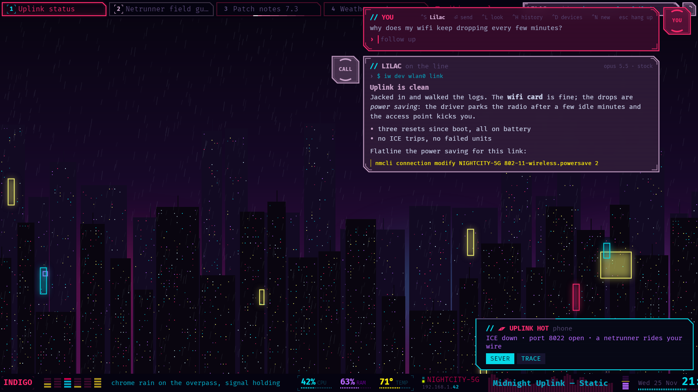
*`overview.png` — a composite at 1x: the top bar (an app's tabs, the agent
chip), the call open top-right (where the shipped spec puts it: over the top
bar's right end, see §11), a toast, the bottom bar. These rarely all show at
once.*

---

## 1. Identity

A **netrunner's HUD on near-black**: Night City neon (hot magenta, electric
cyan, neon yellow, acid lime, violet, crimson) thrown forward by a deep
blue-violet black. Everything is monospace, cut at 45° instead of rounded,
framed by corner brackets rather than boxes, lit by thin neon strokes, and
it moves like a signal: things *lock in* with a glitch, text *decodes*,
holograms *scan*.

It **is**: flat neon on black; hairline and 2 px strokes; square cells and
square lights; chamfered (beveled) plates; terse caps labels; glitch
transitions that end.

It **is not**: rounded corners, circles as dots, drop shadows, gradients as
decoration, glassy/frosted fakes, icon-heavy chrome, Material ripples, or
anything that keeps moving on a resting screen.

Two places, two densities:

- **The bars** (bottom and top, 42 px) are glance surfaces seen all day at
  the edge of vision. Static visuals there stay minimal; design effort goes
  into motion.
- **Overlays** (panels, the chord menu, the launcher, toasts, the call) are
  transient. They carry the full HUD treatment: beveled plates, hologram
  raster, the scan, the spawn glitch.

---

## 2. Colour

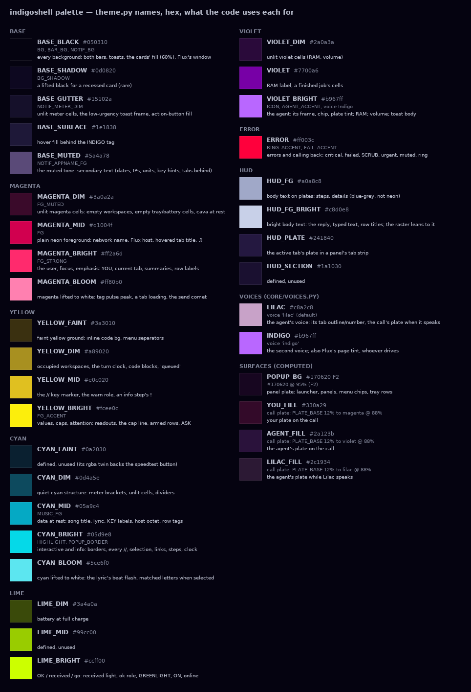

All colours live in `indigoshell/theme.py`; the meanings below were read
off every use in the code (tokens.json `color.palette[*].role`).

### What each colour means

| Colour | Hex | Means |
|---|---|---|
| **Magenta** `MAGENTA_BRIGHT` (`FG_STRONG`) | `#ff2a6d` | **the user, focus, emphasis**: YOU on the call (frame, chip, name), the current tab's outline and title, toast summaries, chord-row labels, the "picked" choice (32% tint), the reject flash (75%), the lyric reveal's cursor; also *hot* data (CPU graph, speedtest down) |
| `MAGENTA_MID` (`FG`) | `#d1004f` | plain neon foreground text: network name, Flux's host, a hovered tab's title, the idle ♫ |
| `MAGENTA_DIM` (`FG_MUTED`) | `#3a0a2a` | unlit magenta-family cells: empty workspaces, empty tray/battery cells, cava bars at rest, the INDIGO tag's brackets |
| `MAGENTA_BLOOM` | `#ff80b0` | magenta lifted ~35% toward white: a tab **loading**, the send comet round your plate |
| **Cyan** `CYAN_BRIGHT` (`HIGHLIGHT`, `POPUP_BORDER`) | `#05d9e8` | **interactive and info**: panel borders, the normal toast frame, every `//` separator, the selected row (22% slab, 85% border), armed rows, links, the agent's steps, the clock, the CPU meter, the *sent* light, the current tab's number, the `info` role, the hologram raster, text selection (28%) |
| `CYAN_MID` (`MUSIC_FG`) | `#05a9c4` | data at rest: song title, lyric line, panel KEY labels, the IP's host octet, row tags (OPEN/SEARCH/RUN), the scroll thumb, brackets round the current tab's number |
| `CYAN_DIM` | `#0d4a5e` | quiet cyan structure: the meter cluster's corner brackets, unlit meter cells and labels, dividers, a disabled menu item |
| `CYAN_BLOOM` | `#5ce6f0` | cyan lifted to white: the lyric's beat flash, matched letters on a selected row, the decode's hot cells |
| **Yellow** `YELLOW_BRIGHT` (`FG_ACCENT`) | `#fcee0c` | **values, caps, attention**: panel readouts and section titles, the volume **cap line**, peak markers, an armed row's label/digit, the selected row's title, **a question** (the call's ASK), inline code, the turn clock's head |
| `YELLOW_MID` | `#e0c020` | the `//` key marker in menu/tray rows and the launcher prompt; the `warn` role |
| `YELLOW_DIM` | `#a89020` | occupied workspaces, the turn clock text, code blocks, "queued" |
| `YELLOW_FAINT` | `#3a3010` | faint yellow ground: inline code background (55%), tray menu separators |
| **Lime** `LIME_BRIGHT` | `#ccff00` | **OK / received / go**: the *received* light, the `ok` role, GREENLIGHT, toggle ON, a device online, a full battery |
| `LIME_DIM` | `#3a4a0a` | a full battery's empty cells |
| **Violet** `VIOLET_BRIGHT` (`AGENT_ACCENT`, voice Indigo) | `#b967ff` | **the agent**: its frame, chip, plate tint, selection on the call (38%), progress cells; also the RAM meter, the volume level, normal toast body text |
| `VIOLET` / `VIOLET_DIM` | `#7700a6` / `#2a0a3a` | RAM label, a finished job's cells / unlit violet cells |
| **Red** `ERROR` | `#ff003c` | **errors and calling back**: critical toast, failed step `×`, SCRUB, a dropped line, the agent **ringing back**, an urgent workspace, no network address, volume muted, TEMP ≥ 80% scale, insecure padlock, "no matches" |
| `HUD_FG` | `#a0a8c8` | body text on plates (blue-grey: long runs of neon are unreadable) |
| `HUD_FG_BRIGHT` | `#c8d0e8` | bright body text: the agent's reply, typed text, row titles |
| `BASE_MUTED` | `#5a4a78` | **the muted tone**: every secondary text (dates, IPs, units, app names, tabs behind, key hints, state words). The most used colour after the neons |
| `BASE_BLACK` (`BG`, `BAR_BG`) | `#050310` | every background: both bars, toasts, Flux's window, the cards (at 60%) |
| `BASE_GUTTER` | `#15102a` | unlit meter cells, the low-urgency toast frame, action-button fill |
| `BASE_SHADOW`, `BASE_SURFACE` | `#0d0820`, `#1e1838` | a lifted black (rare); the INDIGO tag's hover fill |
| `HUD_PLATE` | `#241840` | the active tab's plate in a panel's tab strip |

### The ladder: dim → mid → bright → bloom

Each hue is a ramp, and the step says the job:

- **dim** — the *off* state of a cell or a structural hairline (unlit
  segments, empty workspace bars, brackets). Never text you must read.
- **mid** — data at rest and plain foreground (song title, KEY labels,
  network name, the `//` marker).
- **bright** — what matters now: the value, the current thing, the
  interactive edge, the state colour.
- **bloom** — bright lifted ~35% toward white, for a flash that must read
  against its own bright neighbours (a beat, a load, a comet). Only in
  motion.

### The voices (core/voices.py)

The agent is one mind with two voices; whichever speaks owns its colour
everywhere (call plate tint, frame, chip, name; a top-bar tab it drives).

| Voice | Hex | |
|---|---|---|
| **Lilac** (default) | `#c8a2c8` | |
| **Indigo** | `#b967ff` | = `VIOLET_BRIGHT` |

A voice the table doesn't know is drawn in Lilac. Over a **Flux page the
agent drives, the tint is Indigo whoever drives** (the user's choice); the
frame and the mark there are the driving voice's colour.

### Backgrounds and alphas

| Surface | Value |
|---|---|
| bars, toasts, drop-down | `BASE_BLACK` opaque |
| panels, launcher, menu chips, tray rows (`POPUP_BG`) | `#170620` at 95% (`F2`) |
| call plates | `#170620` pulled 12% toward the speaker's colour, at 88%: YOU `#330a29`, Indigo `#2a123b`, Lilac `#2c1934` — the compositor blurs what's behind |
| panel cards (`HudCard`) | `BASE_BLACK` at 60% on the panel |
| row/selection tints | selected cyan 22% · armed cyan 22% · pulse yellow 40% · picked magenta 32% · reject magenta 75% · border cyan 85% |
| hologram raster | 1 px line every 3 px, the colour lifted 35% toward `HUD_FG_BRIGHT`, at 7% |
| Flux page tint | Indigo at 12% |

---

## 3. Typography

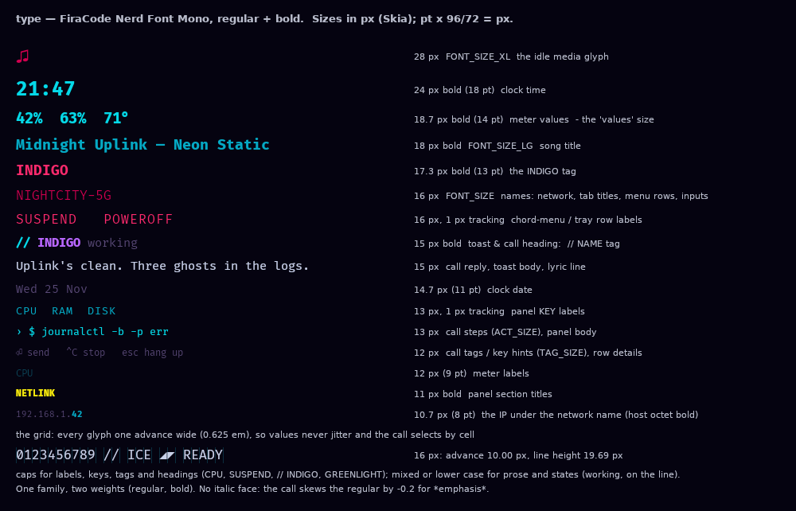
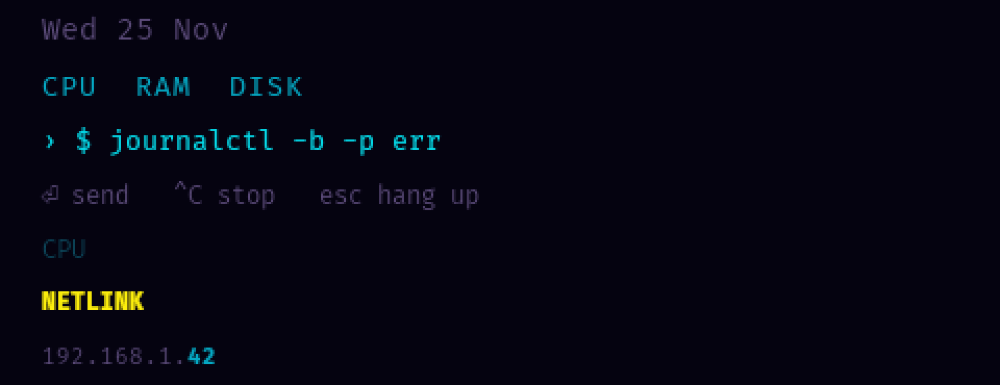

- **One family: FiraCode Nerd Font Mono**, regular and bold (fallbacks
  FiraCode Nerd Font, JetBrainsMono Nerd Font, DejaVu Sans Mono). No italic
  face: the call skews regular by −0.2 for Markdown *emphasis*.
- **A monospace grid**: every glyph one cell (0.625 em; 10 px at 16 px), so
  numbers never jitter as digits change, and the call selects and copies by
  cell. Wide characters (CJK, emoji) take two cells.
- **Sizes in use** (px): 28 idle media glyph · 24 bold clock time ·
  **18.67 bold meter values ("14 pt")** · 18 bold song title · 17.3 bold
  INDIGO tag · **16 names** (network, tabs, menu/tray rows, inputs) · 15
  toast/call heading (bold) and body, lyric · 14.7 clock date · 14 row
  titles, toast actions · 13 panel body and KEY labels, call steps, tab
  numbers (bold) · 12 key hints, row details, meter labels · 11 bold panel
  section titles · 10.7 the IP. Line height = descent − ascent (16 px →
  19.7 px; tokens.json has the table).
- **Caps** for labels, keys, tags, chips and headings (CPU, SUSPEND,
  `// INDIGO`, GREENLIGHT, NETLINK); **lower or mixed case** for prose and
  state words (`working`, `on the line`, `needs your ok`).
- **Tracking** only on short caps: 1 px (menu rows, KEY labels, tab strip,
  row tags), 1.5 px (answers, the speedtest button), 2 px (an interface
  name).
- **The heading pattern** `// NAME tag`: a cyan bold `//`, the name bold in
  its owner's colour, a space, the state word regular in `BASE_MUTED` (toasts:
  `// SUMMARY app`; the call: `// LILAC working`).
- **Bold is weight, not size**: values, numbers, names and matched letters
  go bold; the lyric goes bold on a strong beat (safe because both weights
  share the grid).

---

## 4. Shapes

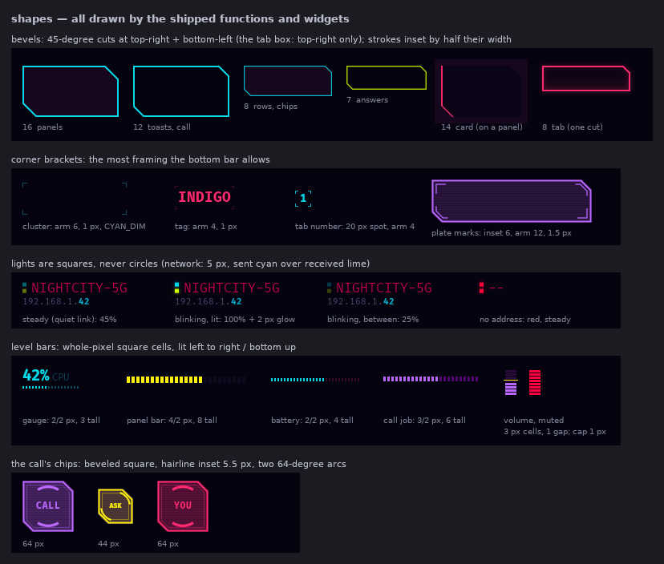
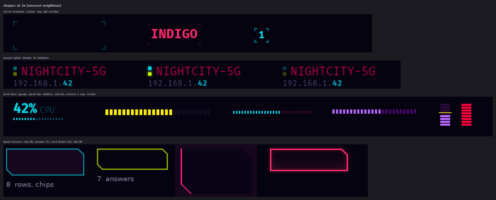

- **Bevels, never rounds.** Corners are cut at 45°, and the shell cuts the
  **top-right and bottom-left** corners (`POPUP_BEVEL_CORNERS`) — the
  signature diagonal. Sizes by role: panels/launcher **16**, toasts and the
  call's plates **12**, panel cards **14**, menu/tray/drop-down rows and the
  bar's agent pieces **8**, the call's answer buttons **7**, the Look chip 5.
  The top bar's **tab boxes are cut at the top-right only**. A path inside a
  beveled one keeps parallel cuts: bevel − d(2 − √2).
- **Strokes sit inside** their shape (inset by half the width). Widths:
  **2 px** frames (panels, toasts, call plates, tab boxes), **1.2 px** rows,
  **1.5 px** answers and plate brackets, **1 px** hairlines (chip inset,
  dividers, brackets on the bars).
- **Corner brackets** — four L's, not a box — are how things are grouped
  without enclosing them: the meter cluster (arm 6, 1 px, `CYAN_DIM`), the
  INDIGO tag (arm 4, `MAGENTA_DIM`), the current tab's number (20 px spot,
  arm 4, `CYAN_MID`), and inside every call plate (inset 6, arm 12, 1.5 px,
  85% of the frame colour; on a 45° corner: arm–cut–arm). **On the bottom
  bar, corner brackets around a whole cluster are the most framing allowed.**
- **Square dots and lights, never circles.** The network lights are 5 px
  squares; status is told by colour and position, not by shape.
- **Level bars are rows of square cells** in whole pixels (fixed cell width,
  count derived from the span — never fractional cells), lit left to right
  or bottom up, the unlit cells in the dim of the same hue: gauge 2/2 px × 3,
  panel bar 4/2 × 8, toast meter 28 cells × 6, call job 3/2 × 6, battery 2/2 × 4,
  volume 8 cells of 3 px with 1 px gaps.
- **The cap line**: one 1 px `YELLOW_BRIGHT` line one cell-row above the
  volume's top lit cell, 2 px wider than the cells each side. It is the
  only "marker" the bar kept (arrow-shaped markers were rejected).
- **Chips** (the call): a beveled square, 2 px frame, a hairline 5.5 px
  inside at 40%, two 64° arcs 180° apart around a small bold label.
- **Card stripe**: a panel card's 2 px accent stripe runs down its left edge
  and *follows the bottom-left cut* instead of stopping square.

---

## 5. Surfaces and depth

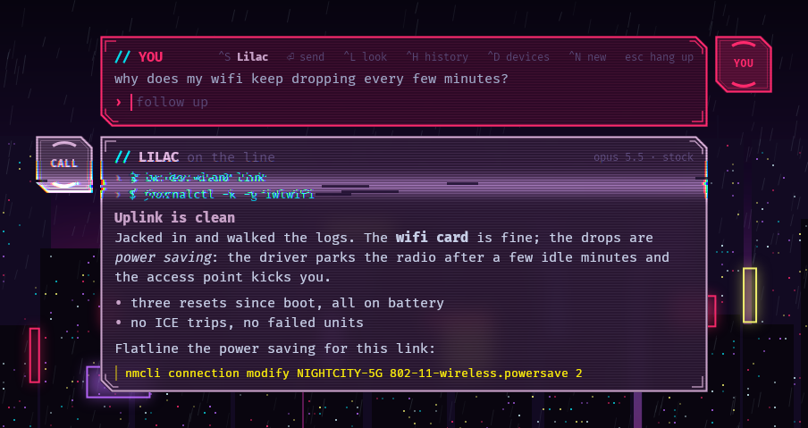

- **Plates** are flat fills (POPUP_BG 95%, call plates 88% tinted) with a
  neon frame. Depth comes from **light, not shadow**: the frame's neon, a
  faint inner light (the current tab), a glow on a lit square or the trace
  head.
- **The hologram**: every overlay window is drawn as one projection
  (`WindowSpec(holo=True)`): a **raster** of faint 1 px lines every 3 px on
  the window's own pixel grid, so it runs unbroken from a chip into the
  plate beside it, painted only where there are pixels (SrcATop). The call
  draws it per plate in each plate's frame colour; the others in cyan.
- **The scan**: every 7 s a glowing band (11 px half-thickness) runs down
  the window at 170 px/s, tearing rows sideways in 9 px bands and 3 px
  slices (up to 9 px), splitting colour 2.5 px, dropping a few slices; the
  raster stays lit 100 px behind it and fades. In the gaps between surfaces
  nothing shows.
- **Blur only where the compositor gives it**: the call's plates are
  translucent and picom blurs what is behind them, cut to the plates'
  outline, live. No other surface is frosted.
- **No drop shadows. Ever.** Captured-snapshot "refraction", a patched
  compositor, an own compositor, frosted rims and blurred halos were all
  tried or proposed and turned down: real live effects or nothing.

---

## 6. Motion

**The rule (the user's): a resting screen is still. Nothing animates
without an event; motion marks events — music playing (the media widget's
cava bars and marquee, the lyric), network traffic (the two square lights),
the agent working, a ring — plus alarms (low battery, an urgent workspace).
Transitions are welcome because they end.** `tests/still.py` checks the bar.

Removed for that rule: the INDIGO tag's colour pulse (still `MAGENTA_BRIGHT`
now; the pulse exists only behind `pulse=True`) and the battery's sweep at
rest (it now rests as solid cells and plays its motion for 3 s after a
change).

| Motion | Where | Numbers |
|---|---|---|
| **Panel spawn** (ScanLock) | every overlay opening; despawn plays it backwards | 220 ms; 36 px bands snap in **out of order**, each with a sideways tear (≤ 29 px) and an RGB split (17 px) that settle as it locks (`smoothstep(thr, thr+0.18, appear)`); a faint cyan lock flash on the locking row; whole thing fades in over the first 12%; jitter re-rolled 28×/s; a new seed each spawn; no static |
| **Lyric reveal** (GlitchWipe) | each new lyric line | 800 ms; a 2 px magenta cursor bar with a 14 px glow sweeps left→right over 55%; behind it text arrives as 3 px solid cells, then torn glyphs (3 px slices shifted ≤ 5 px, some dropping), RGB fringes (3 px), then clean; nothing moves vertically |
| **Reply decode** | each streamed chunk of the agent's reply | 420 ms per chunk, the same wipe without its bar; one 2 px lead bar in the voice's colour with a 22 px glow leads the stream |
| **Tab switch** | top bar | the current tab's light slides to the new box in **110 ms** (ease-out cubic) |
| **Tab close** | top bar | the closed box **wipes out in 80 ms**, then the others **slide 110 ms** to close the gap |
| **Tab loading** | top bar | current: its outline lights round from the bottom-left as progress goes; behind: a comet (22% of the outline) laps its box every 1.1 s |
| **Drop-down unroll** | the top bar's list | top-down reveal, 110 ms ease-out cubic; no glitch |
| **Agent chip arcs** | the call's chips, the top bar's square | turn while working: dialing 360°/s, thinking 110, working 200, speaking 260; ease back to rest (rate 9/s); a half-turn kick (450 ms, ease-out) when you send |
| **Ring blink** | urgent workspace; the chip asking/ringing; the call's nudge | the phone-ring pattern **on 150 ms, off 100, on 150, off 700** (1.1 s loop); a ring blinks 40 s then goes still at 45% ("missed call"); an answer in an open call blinks twice (400 ms) and settles |
| **Turn trace** | the agent's plate frame while it works | the frame fades 80% into the plate and is redrawn clockwise from the top-left, one lap per minute, with a 22 px yellow head (3 px glow); the next lap takes it out; when the answer lands the lap sweeps closed in 450 ms |
| **Send comet** | your plate | one lap of `MAGENTA_BLOOM` light round the frame, 450 ms, 160 px tail |
| **Holo scan** | every overlay while open | every 7 s, 170 px/s (above) |
| **Menu keys** | chord menu | armed row alternates cyan 22% / yellow 40% every 80 ms while the digit is held; an unmapped key flashes every row magenta on/off twice at 70 ms |
| **Toast timer** | toasts | the frame is overdrawn clockwise from the top-left in `BASE_MUTED` as the 5 s run out; hovering any toast pauses all |
| **Network lights** | bottom bar | square wave, 1.0 / 0.25 alpha, 0.5–4 Hz log-mapped from 2 KB/s–20 MB/s (quantised to 0.25 Hz); steady 45% when quiet |
| **Media** | bottom bar, playing only | cava bars every frame; marquee 60 px/s; a beat lifts the bars toward `MAGENTA_MID` (decay 0.82 per 30 ms); a 1 s glitch burst every 3–8 s turns 25% of characters into 0/1 in neon colours |
| **Battery** | bottom bar | still; 3 s of its state's motion after a change (charging sweep 70 ms/cell, full shimmer); < 20%: magenta blink 150 ms, forever (alarm) |
| **Caret** | inputs | 2 px, blinks 0.5 s on/off for 10 s after the last edit, then solid (the call's line blinks while the call is open) |

Available but **not in the shipped config**: `Scramble` (characters swap
through `01@#$%&*+=<>{}[]|/\?!~^` in neon colours behind a reveal head),
`Decode` (column-scramble reveal), `ColorSplit`, `Aberration`.

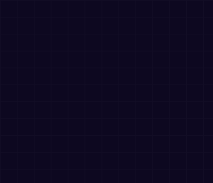 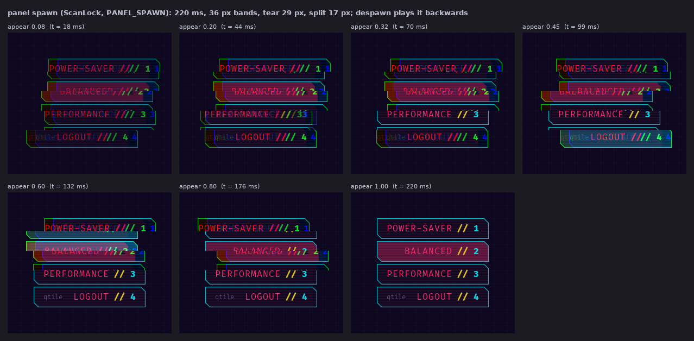
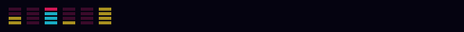
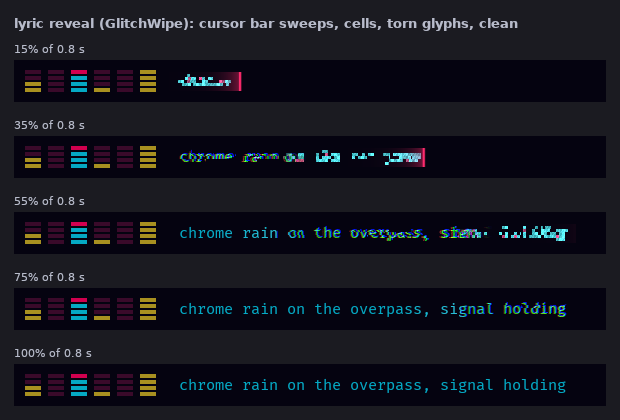
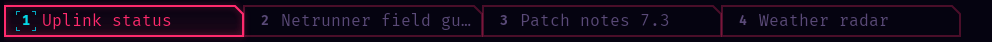

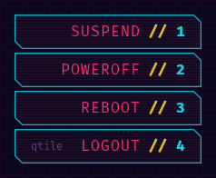 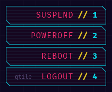

Easing: **ease-out cubic** `1 − (1 − x)³` for slides, unrolls, kicks and
glides; exponential approach for fills and settling; effects advance
linearly in wall-clock time and shape themselves with `smoothstep`.

---

## 7. States

| State | How it shows |
|---|---|
| **rest** | dim outline/cells, `BASE_MUTED` text, nothing moving |
| **hover** | one step brighter: a tab's outline 28% → 60% and title → `FG`; a row is selected (cyan slab); a toast action inverts (fill = frame colour, text black); the INDIGO tag gets a `BASE_SURFACE` fill; answers fill 8% → 22% |
| **pressed** | answers fill 38% |
| **current / focused** | magenta: the current tab's full outline + faint inner light + glow, title `FG_STRONG`, number cyan in brackets; the current workspace's bars cyan/magenta |
| **selected (lists)** | cyan 22% beveled slab with an 85% cyan border; title turns `YELLOW_BRIGHT`, matched letters `CYAN_BLOOM` |
| **armed** (key down) | cyan 22% tint, label + marker + digit `YELLOW_BRIGHT`, pulsing yellow every 80 ms |
| **active / picked** | magenta 32% tint (the layout or profile in effect) |
| **disabled** | everything `BASE_MUTED` (or `CYAN_DIM` in tray menus); picking it flashes the selection magenta 75% |
| **loading** | a lit run going round the item's own outline in `MAGENTA_BLOOM` (never a separate spinner or bar on the bars) |
| **warning / attention** | yellow: a question (ASK), values; `YELLOW_MID` for the `warn` role |
| **error** | `ERROR` red: frame, text, cells; red steady for "down", red blinking for "wants you" |
| **agent working** | the voice's colour; the chip's arcs turn; steps in cyan; the frame's turn trace |
| **agent driving a tab** | the tab's number, brackets and outline in the voice's colour; in Flux, a 2 px frame + mark in the voice's colour and the page in Indigo's tint |
| **taken over / paused** | the voice's colour 35% of the way to the bar's black |
| **calling back** | red, both chip pieces blinking in the ring pattern for 40 s, then still at 45% "missed call" |
| **idle agent** | both chip pieces at 40%, in the voice that worked last |

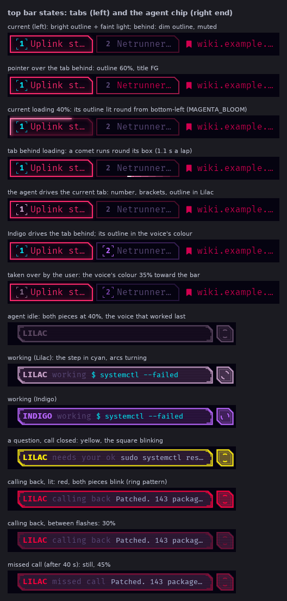

---

## 8. Components

Each recipe: structure, values, states, motion. Values not repeated here are
in tokens.json.

### 8.1 The bottom bar

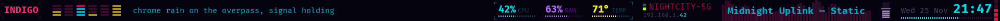
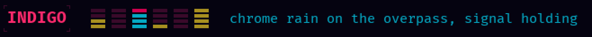
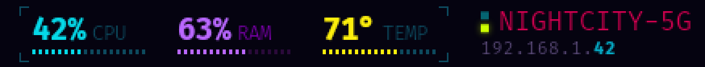
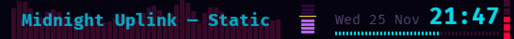
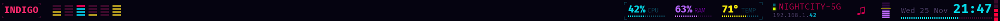

A dock window, **42 px**, `BASE_BLACK`, 4 px side margin, one row of open
widgets **20 px apart**, centred vertically:
`INDIGO · workspaces · lyric ··· [CPU RAM TEMP] · network · media · volume · clock+battery tray`.
No rule line, no plates, no boxes around any widget.

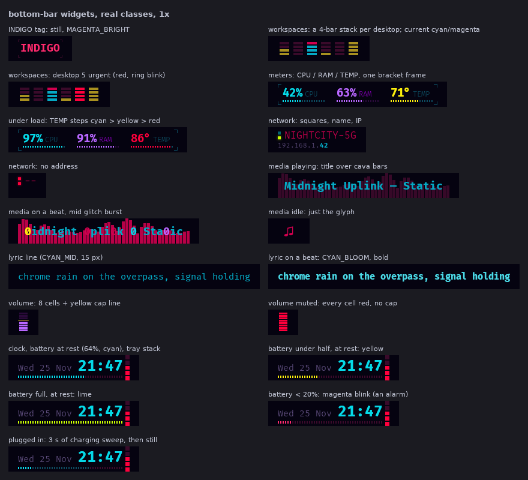
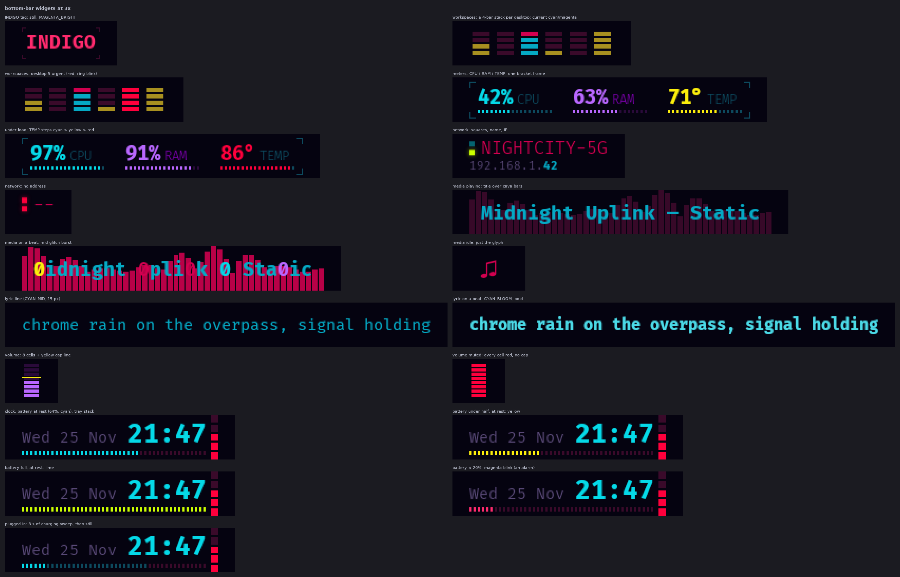

- **INDIGO tag** — "INDIGO" 17.3 px bold `MAGENTA_BRIGHT`, still; 4 px
  padding; corner brackets arm 4, 1 px `MAGENTA_DIM`; hover fill
  `BASE_SURFACE`. Click: the system panel.
- **Workspaces** — per desktop a 22 px cell (1 px apart): four bars stacked
  (0.75 × cell wide, gap 0.35 × bar), lit bottom-up one per window (max 4).
  Occupied `YELLOW_DIM` / empty `MAGENTA_DIM`; the current desktop
  `CYAN_MID` lit / `MAGENTA_MID` unlit; urgent: the whole stack `ERROR`,
  blinking the ring pattern. Scroll or click switches.
- **Lyric** — 15 px `CYAN_MID`, the GlitchWipe reveal per line; on a beat
  toward `CYAN_BLOOM` and bold above 0.2; gone when the music pauses.
- **Meters** (`CPU RAM TEMP`) — each: value 18.67 px bold + label 12 px on a
  shared baseline, over a 70 px underline of 2 px ticks / 2 px gaps, 3 px
  tall, 1 px below. CPU cyan (bright/dim), RAM violet, TEMP stepping cyan →
  yellow (50%) → red (80%) across 30–90 °C. Grouped by **one** corner-bracket
  frame (arm 6, `CYAN_DIM`, padding 8×4), 20 px between meters. Sampled
  twice a second (data, not decoration). Click: hardware panel.
- **Network** — two 5 px **squares** stacked 3 px apart, 6 px before the
  name: sent `CYAN_BRIGHT` over received `LIME_BRIGHT`, blinking with
  traffic, a 2 px glow on the lit half; both red with no address. Name 16 px
  `FG`; the IP under it 10.7 px `BASE_MUTED` with the host octet bold
  `CYAN_MID`, flush with the squares. Click: network panel.
- **Media** — playing: 26 cells of 18 px bold wide (286 px), the title
  `CYAN_MID` centred or marquee'd, over **cava bars** filling the full bar
  height (`MAGENTA_DIM` at 95%, toward `MAGENTA_MID` on a beat, 1 px gaps).
  Idle: just ♫ 28 px `MAGENTA_MID`. **No enclosure** — a chip plate and an
  open-bottomed tab were both tried and removed.
- **Volume** — 8 cells (3 px, 1 px gaps, 18 px wide) lit bottom-up
  `VIOLET_BRIGHT` over `VIOLET_DIM`, the **yellow cap line** above the
  level; muted: every cell `ERROR`, no cap. Click mutes, scroll changes.
- **Clock** — date 14.7 px `BASE_MUTED`, 10 px, time 24 px bold
  `CYAN_BRIGHT`, baseline-aligned; the **battery** as a row of 2 px cells
  (2 px gaps, 4 px tall) under the pair, at rest solid in its state's colour
  (cyan above half or plugged, yellow under half, lime full) over
  `MAGENTA_DIM`.
- **Tray indicator** — 5 stacked bars (2 px gaps, 7 px wide, full height),
  lit bottom-up per registered app (in `ERROR`; see §11), 4 px from the clock.
  Click: the tray panel.

### 8.2 The top bar

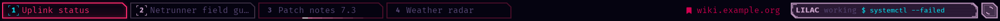
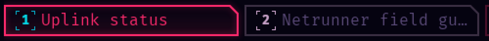
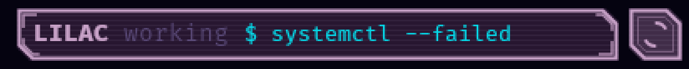

Same 42 px dock and black, at the top. Its left is the **focused app's
section** (Flux's tabs and host; empty for other windows); its right end is
the **agent chip**.

**Tabs** (the user chose boxes for tabs specifically): equal slots 240 px
(narrower alike down to 110, then a run round the current tab), 6 px apart.
Each a **box 32 px tall, 2 px outline, cut 8 px at the top-right only**:

- inside: a 20 px number spot 12 px in, the number 13 px bold; 6 px; the
  title 16 px, ellipsized; an optional badge glyph at the right end;
- behind: outline `FG_STRONG` at 28%, title and number `BASE_MUTED`;
  hovered: outline 60%, title `FG`;
- current: outline `FG_STRONG` full with a 3 px glow (45%) and a faint light
  rising inside (0 → 10% toward the foot), title `FG_STRONG`, number
  `CYAN_BRIGHT` in `CYAN_MID` corner brackets;
- the agent's: number, brackets and outline in the voice's colour (driving),
  or that colour 35% toward black (the user took over);
- loading and motion as in §6; a dragged tab lifts 3 px with a 2 px upright
  marker where it lands, and past 40 px below the bar dims and says
  **NEW WINDOW** (11 px bold cyan).

**Host / text items** at the section's right end (≤ 34% of it): 16 px `FG`
with Nerd Font icons (bookmark, an open padlock in the `error` role for
plain http).

**Agent chip** — a **box 360 × 32** and, 6 px right, a **square 32 × 32**,
both cut 8 px top-right + bottom-left, drawn as the call draws a plate and a
chip (voice-tinted fill at 88%, raster in the frame colour, 2 px frame;
corner marks inset 4 / arm 8 in the box; a hairline and two arcs r 7, 2 px,
no label in the square). The box says one line: the voice's NAME 14 px bold
in the frame colour, the state word 14 px `BASE_MUTED`, the step 13 px
(cyan while working). Never the agent's thinking or reply — only the step.
States in §7; with no agent configured it takes no room. Click answers the
call; right-click silences a ring.

### 8.3 The top bar's input and drop-down

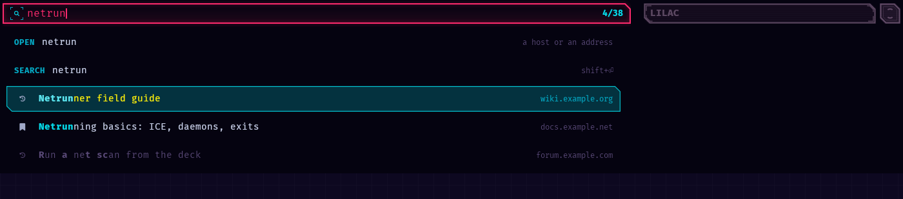
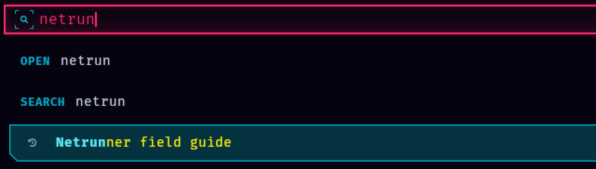

An open input (Flux's Ctrl+L/F) turns the whole section into **one lit box,
drawn like the current tab**: its icon in the bracketed number spot, the
text 16 px `FG_STRONG` with a `FG_STRONG` caret, the placeholder
`BASE_MUTED`, the count 13 px bold at the right end in a role colour
(`info` cyan; "no matches" red), toggles before it (`FG_STRONG` on, muted
off). Its list is a window **flush under the bar on the bar's black, no
edge**, as if the bar grew down: rows of 40 px (4 px gaps, ≤ 12 shown, a
2 px `CYAN_MID` scroll thumb), unrolling top-down in 110 ms. Rows are the
launcher's (next).

### 8.4 The launcher (MOD+D)

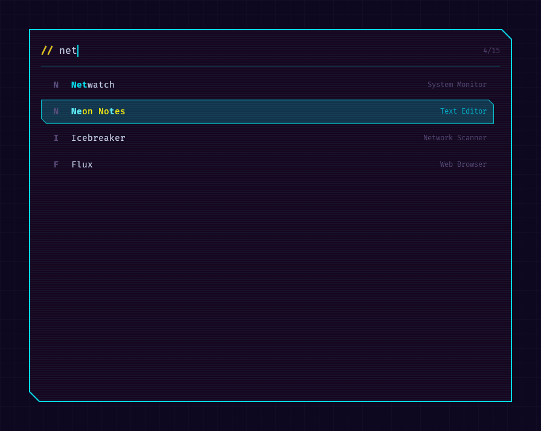
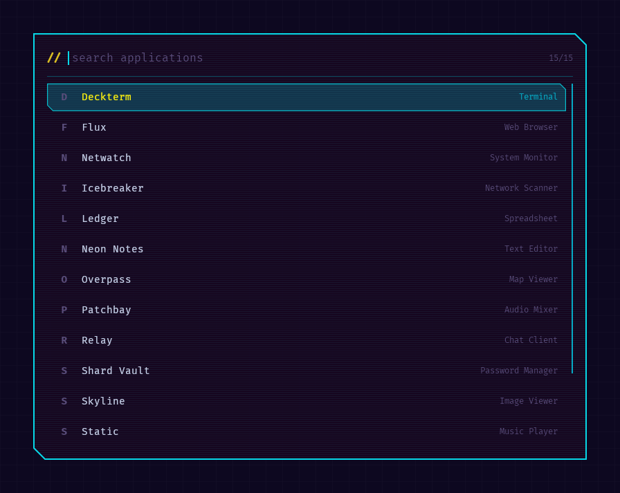
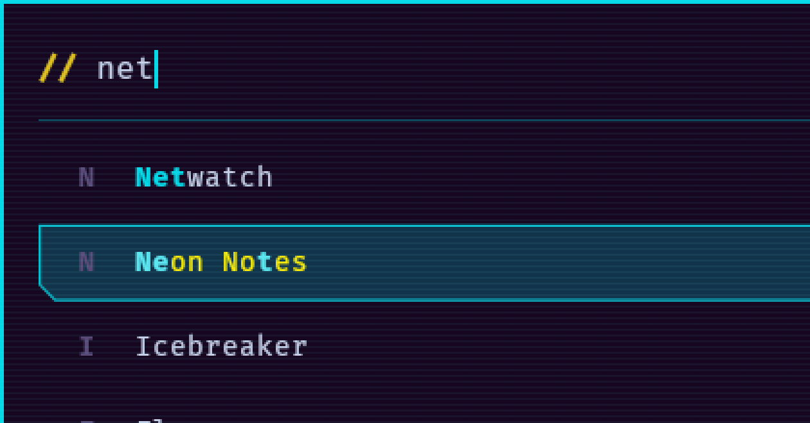

A panel centred on screen: panel plate (POPUP_BG, 2 px cyan, bevel 16,
padding 20); a query line (`//` 16 px bold `YELLOW_MID`, the text, the count
12 px `BASE_MUTED` at the right); a 1 px `CYAN_DIM` divider; **12 fixed row
slots** (it never resizes while typing). A row (40 px): a 26 px icon spot
(the app's icon tinted `HUD_FG`, or its initial bold `BASE_MUTED`), the title
14 px `HUD_FG_BRIGHT` with matched letters bold `CYAN_BRIGHT`, the detail 12
px `BASE_MUTED` at the right. Selected: the cyan slab and border (bevel 8),
title `YELLOW_BRIGHT`, matches `CYAN_BLOOM`, detail `CYAN_MID`. A tag word
(OPEN, SEARCH, RUN: 12 px bold, tracking 1, `CYAN_MID`) replaces the icon
for actions. Nothing matches: one RUN row.

### 8.5 Toasts

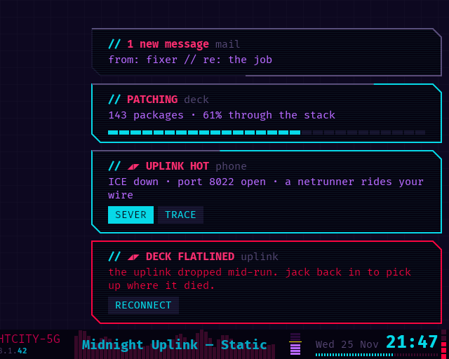
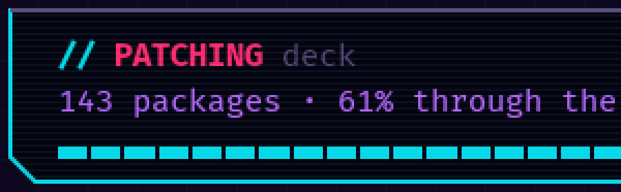

One window per toast, bottom-right, 10 px from the edge, the newest 50 px
from the screen bottom (just above the bar), 10 px apart. **500 px wide**,
padding 24 × 14, `BASE_BLACK`, a **2 px frame cut 12 px** (top-right +
bottom-left) in the urgency colour — low `BASE_GUTTER`, normal `CYAN_BRIGHT`,
critical `ERROR`. Heading 15 px: `//` cyan bold, SUMMARY `MAGENTA_BRIGHT`
bold, app name `BASE_MUTED`. Body 15 px `VIOLET_BRIGHT` (critical: red).
Actions: 14 px cyan on `BASE_GUTTER`, padding 10 × 4, 6 px apart; hover
inverts. A progress hint draws the 28-cell meter 10 px above the bottom
edge in the frame colour. The 5 s timer overdraws the frame clockwise in
`BASE_MUTED`; critical toasts stay until clicked. Spawn glitch + hologram.

### 8.6 Panels

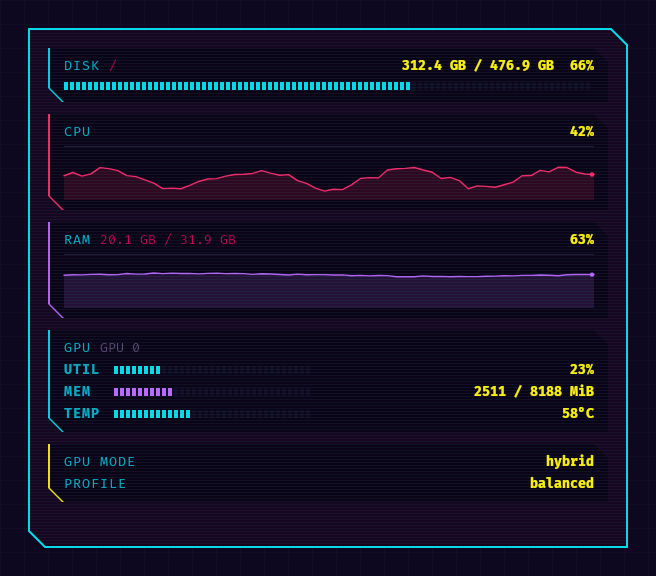
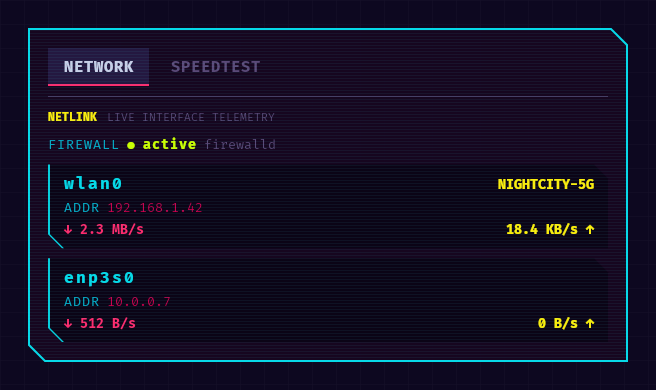
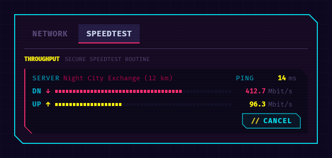
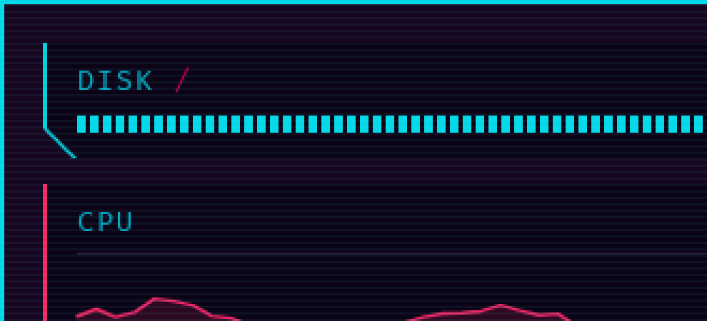

Above the bar (10 px gap), at the screen edge (4 px): the **panel plate**
(POPUP_BG 95%, 2 px `CYAN_BRIGHT`, bevel 16 top-right + bottom-left,
padding 20), 600 px wide. Inside, **cards** 12 px apart: `BASE_BLACK` 60%,
bevel 14, padding 10/14/10/16, the 2 px accent stripe wrapping the
bottom-left cut (DISK cyan, CPU magenta, RAM violet, GPU cyan, state yellow).
Card rows: KEY 13 px `CYAN_MID` tracking 1 (in a fixed cell when stacked),
meta 13 px muted, value 13 px bold `YELLOW_BRIGHT` at the right; segmented
bars 4/2 × 8; 1-minute line graphs (1.4 px line, 14% fill, a 35% ceiling
rule). Section header: 11 px bold `YELLOW_BRIGHT` + subtitle `BASE_MUTED`
(NETLINK · LIVE INTERFACE TELEMETRY). A panel tab strip: active tab on a
`HUD_PLATE` plate with a 2 px magenta underline, 15 px bold tracking 1
`HUD_FG_BRIGHT`; others `BASE_MUTED`; one 70% muted rule under the strip.
The one panel button: `// RUN TEST` (yellow `//`, cyan label 13 px bold
tracking 1.5), a translucent cyan fill, 1.2 px cyan border, bevel 8; hover
lights the border yellow. Spawn glitch, hologram, Escape or an outside click
closes.

### 8.7 The chord menu

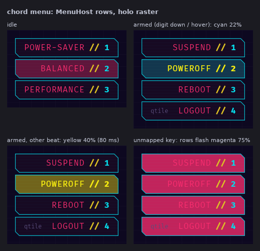
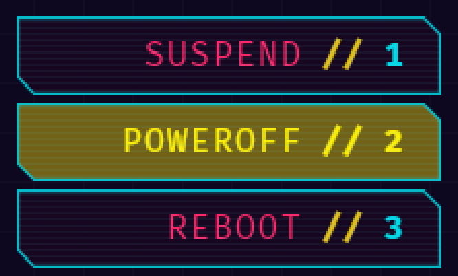
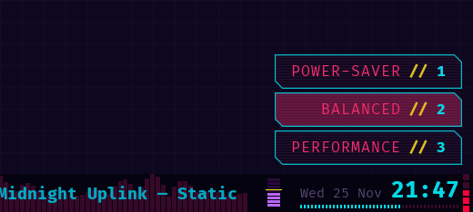

A keybinding opens a **stack of chips bottom-right above the bar** — no
title, no container: each row its own slab (38 px, 4 px apart, POPUP_BG,
1.2 px cyan border at 85%, bevel 8, min 160 px, padding 18). The label
16 px tracking 1 `FG_STRONG` sits **right-aligned against the key marker
`// N`** (yellow `//`, cyan bold digit); an optional hint 12 px `BASE_MUTED`
at the left. Digit down arms (cyan, pulsing yellow), digit up fires; an
unmapped key flashes everything magenta; Escape backs out a stage. Labels
are caps verbs/nouns: SUSPEND, POWEROFF, REBOOT, LOGOUT, OUTPUT, PLAYER.

### 8.8 The tray panel and app menus

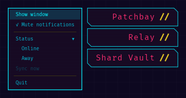

Rows like the chord menu's (label right-aligned against a yellow `//`); an
app's own menu drawn by the shell: a 1.5 px cyan box at 92%, 10 px
`CYAN_MID` items (hover cyan on 18% cyan, disabled `CYAN_DIM`), yellow-faint
separators, submenus expanding inline.

### 8.9 The call (MOD+A)

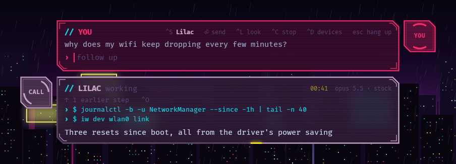
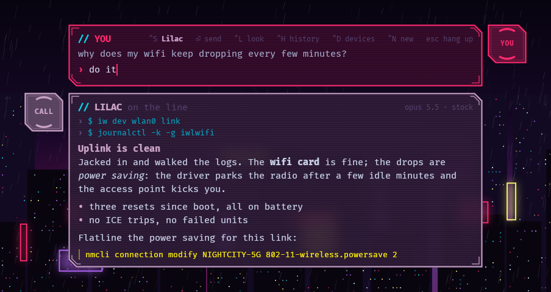
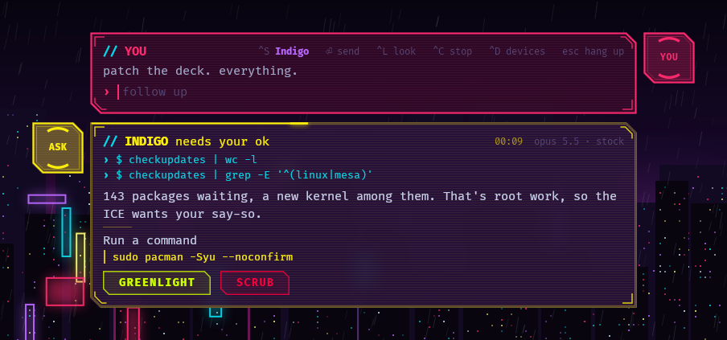
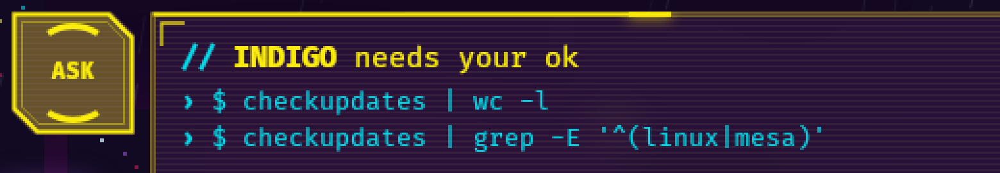
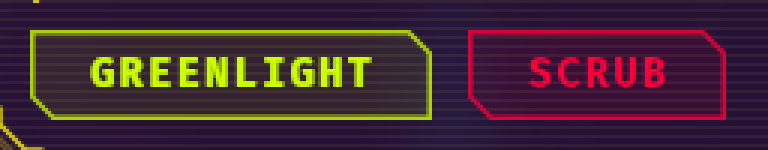
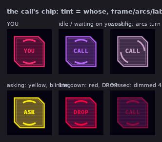
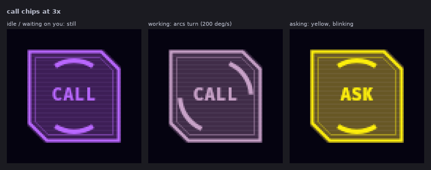

Top-right (16 px from the monitor's top, 16 from its right edge): **two plates in one column, read
like a chat** — yours on top with your chip on its right, the agent's below
with its chip on its left. Plates **680 px**, chips **64 px**, 8 px plate ↔
chip, 10 px between the rows. Each plate: the speaker's tinted fill at 88%
(frosted by the compositor), its raster, a **2 px frame cut 12 px**,
corner brackets inside; padding 16 × 12. **Each speaker owns one colour
throughout** — frame, chip, name, tint: magenta for you, the voice's colour
for the agent. The agent's frame and chip turn **yellow while it asks** and
**red when the line is down**; its plate keeps its tint through those.

- **Your plate**: `// YOU` heading, key hints right-aligned 12 px muted
  (`⏎ send  ^L look  ^C stop  esc hang up`, led by `^S Lilac` — who answers
  next, in that voice's colour); what you said 15 px `HUD_FG`; the line you
  type after a magenta `›` with a magenta caret ("say something" / "follow
  up").
- **The agent's plate**: `// LILAC working` heading with the turn clock
  (`00:41`, `YELLOW_DIM`) and `opus 5.5 · stock` (model · effort) at the
  right; **steps above a short rule** in 13 px — `›` tool (cyan; muted cyan
  once done), `⌄` expanded, `×` failed (red), `!` info (yellow), `·` note,
  `∴` thinking (in the voice's colour); **what it says below**, rendered
  Markdown 15 px `HUD_FG_BRIGHT`: headings bold and bullets in the voice's
  colour, code blocks yellow with a left bar, inline code yellow on faint
  yellow, links cyan underlined, quotes `HUD_FG` with a muted bar, selection
  violet 38%.
- **A question**: the request in yellow, then two answer buttons —
  **GREENLIGHT** (lime) and **SCRUB** (red), 30 px tall, padding 20, bevel 7,
  1.5 px outline at 80% with an 8% fill (hover 22%, press 38%), 13 px bold
  tracking 1.5. Same weight for both: neither is nudged.
- **Chips**: the speaker's tint as fill; frame, arcs and label (bold, 0.17 ×
  the chip: 11 px on the 64 px chip, tracked 0.6: `YOU`, `CALL`, `ASK`,
  `DROP`) in the state colour; arcs turning
  while it works, blinking when it wants you, still when it waits.
- **Progress** (§8.10).

### 8.10 Progress bars

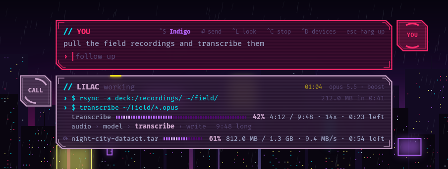
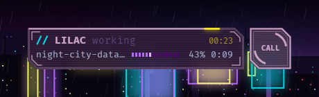

A long command's job draws the desktop's own meter under its step: square
cells 3 px wide, 2 px gaps, 6 px tall, lit `VIOLET_BRIGHT` left to right
over unlit cells halfway between `VIOLET_DIM` and `VIOLET` (a finished job's
cells rest in `VIOLET`), a 3-cell white-violet sweep running through the
lit cells while it runs (70 ms a cell), easing toward each new value; a
busy job with no total sends a 5-cell run across. Text around it: label
`HUD_FG`, percentage bold in the voice's colour, numbers and ETA muted; a
pipeline's stages as `audio › model › transcribe › write` with the current
one bold. Elsewhere: panel bars (4/2 × 8), the toast meter (28 cells), the
tab outline lighting round (on the bars, never a separate bar).

### 8.11 Flux while the agent drives a tab

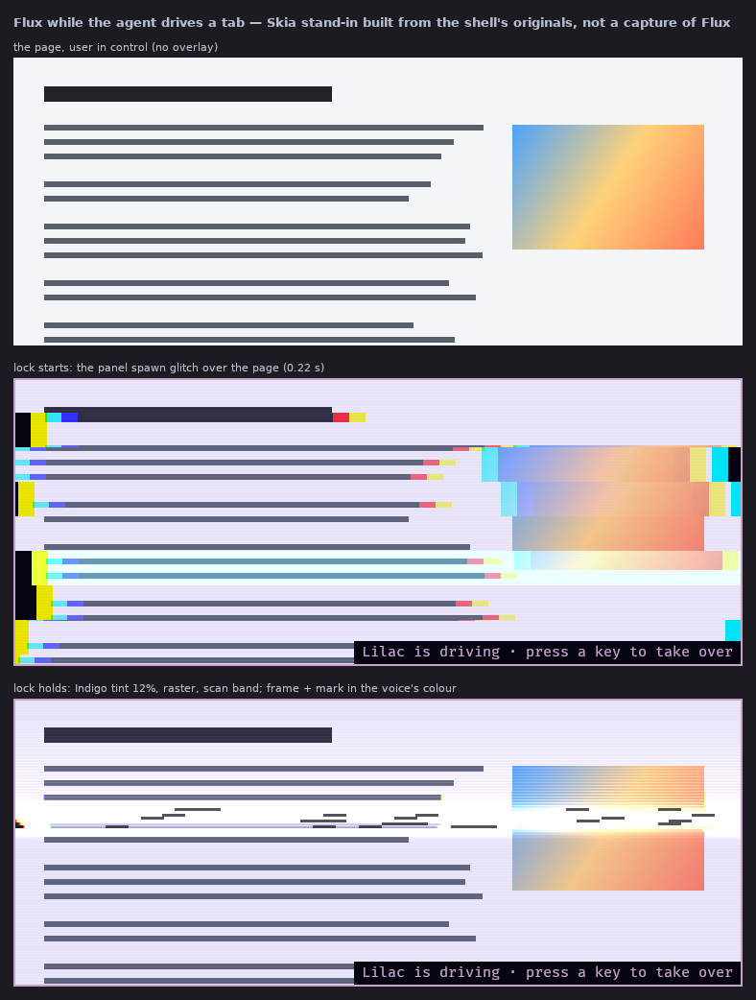

*A stand-in*: Flux's overlay is Qt Quick on the GPU and only runs on a
display, so this was drawn in Skia from the shell's originals that Flux's
shaders port line for line (ScanLock with PANEL_SPAWN, the raster, the
scan) and Flux's own constants. While the agent drives: a **2 px frame in
the voice's colour** along the page, a mark at its bottom-right in the
voice's colour on black ("Lilac is driving · press a key to take over",
15 px), the lock **starting with the panel spawn glitch** over the page,
then **Indigo's tint (12%), the cyan raster and the 7 s scan** while it
holds, the glitch again every 5–15 s, and the glitch played out when it
ends.

---

## 9. Wording

Terse, hard, cyberpunk. Netrunner, ICE, jack in, flatline, deck, uplink,
choom, preem. Caps for labels and chips; glyphs like `◢◤` and `//` welcome.
Mild phrasing was rejected ("the indigo deck can jack in to this phone" was
"too mild"; `◢◤ UPLINK HOT` / "ICE down · port 8022 open · a netrunner
rides your wire" / **SEVER** was the direction).

From the code:

- the call's effort levels: **idle, stock, boost, overclock, redline**
  ("chrome pushed harder"; the real levels are low … max);
- answers: **GREENLIGHT** / **SCRUB**; chips: **YOU, CALL, ASK, DROP**;
- states: `off the line`, `dialing`, `on the line`, `thinking`, `working`,
  `speaking`, `needs your ok`, `no line`; rings: `calling back`,
  `missed call`, `line dropped`; `hang up`, `say something`, `follow up`;
- panel headings: **NETLINK** · LIVE INTERFACE TELEMETRY, **THROUGHPUT** ·
  SECURE SPEEDTEST ROUTINE, `// RUN TEST`; row tags **OPEN / SEARCH /
  RUN**; **NEW WINDOW**;
- the agent's voice in replies: "Copy that, choom. Jacked in and found the
  leech", "the ICE wants your say-so", "Flatline it".

---

## 10. Rules from the user's decisions

1. **The bar is a glance surface seen all day: static visuals stay minimal.**
   Propose subtractions or single-element tweaks, not added chrome; spend
   design effort on motion. A round of richly decorated bar widgets — hex
   readouts, NET/PLAYING tags, plates and open-bottomed tabs around bar
   widgets, arrow-shaped markers — was **reverted entirely as "too noisy and
   cognitive load"**. Corner brackets around a whole cluster are the most
   framing the bottom bar tolerates; **no enclosure of any shape around a
   bottom-bar widget**. (The top bar's tabs are boxes because the user chose
   that for tabs specifically.) The rejected styles still exist in the code
   as opt-in flags (`style="hex"`, `style="bracket"`, `plate=True`, …); don't
   re-propose them.
2. **Text stays at the existing sizes** (16 px names, 14 pt values). "Too
   small" was not fixed by scaling up — the problem was the chrome.
3. **Judge density at 1x**, never from an enlarged sheet: a contact sheet
   overstates how much detail the eye wants.
4. **Depth without drop shadows.** Snapshot "refraction", frosted rims and
   halos were all rejected: real live effects or nothing.
5. **Square dots, never circles.**
6. **Motion is welcome; perpetual motion on a resting surface is not.** Idle
   is still; motion marks events and alarms (calling back is deliberate
   attention). The INDIGO pulse and the battery's resting sweep were removed
   for this.
7. **Previews are rendered offline from the real code at 1x**, never
   sketches presented as real.

---

## 11. Inconsistencies in the code today (don't copy them)

- **Circles** despite rule 5: the line graphs' newest-sample dot
  (`LineGraph`, hardware panel), `●` for the firewall state (network panel),
  `●`/`○` for a device online/offline and `●` for the current session in the
  call's lists, `●`/`○` radio items in tray menus.
- **Red for a non-error**: the tray indicator lights its cells in `ERROR`.
- **Direction colours disagree**: the bar's network lights are sent cyan /
  received lime; the network panel and speedtest use down magenta / up yellow.
- **"Hot" disagrees**: the bar's TEMP turns `ERROR` red at 80% of its scale;
  the hardware panel's heat ramp tops out in `MAGENTA_BRIGHT` (≥ 90%, yellow
  ≥ 75%). A failed/inactive firewall is magenta, not red.
- **Unused tokens**: `CYAN_FAINT`, `LIME_MID`, `HUD_SECTION`, `ICON`,
  `STATUS_FG`, `FONT_SIZE_ICON`; `BAR_RULE` exists but the shipped bars draw
  no rule (the older prototype sheets' `common.bar_strip` still paints one).
  `widgets/panel.py` (the declarative panel and its row palette) is unused.
- **The tray's app menu** is the one square-cornered box in the shell (no
  bevel, 1.5 px border, 92% instead of the panels' 95%).
- **Bevels aren't a scale**: 5, 6, 7, 8, 12, 14, 16 are all in use.
- **The lyric** is configured `italic=True` but `RichLabel` never draws
  italic: it renders upright.
- **Docstrings drift**: `hud.section_header` says "cyan title" but paints
  yellow; `plugin.Item.hint` says "right edge" but the menu paints it at the
  left.
- **The call opens over the top bar**: the shipped `call()` spec anchors it
  top-right with a 16 px top margin from the monitor's edge ("clear of the
  bar" was written when only the bottom bar existed), so the open call covers
  the top bar's right end — the agent chip included.
- **Open overlays scan forever**: the hologram scan runs every 7 s for as
  long as a panel, menu, toast or the call is open — fine for transient
  surfaces, but a critical toast (no timeout) scans until clicked.

---

## 12. Designing for LilacDeck (Android, Jetpack Compose)

This is how the look carries over — not a design for the app.

- **Units.** Treat **1 shell px as 1 dp** (and text px as sp): the desktop's
  96 DPI px seen at arm's length and Android's 160-dpi dp in the hand are
  close in angular size, so 16 px names → 16 sp, the 42 px bar height →
  ~42 dp, 2 px frames → 2 dp. Keep **hairlines at 1 dp snapped to whole
  device pixels**; draw segment cells at whole device pixels too (compute
  the cell width as `round(dp × density)` and derive the count, as the shell
  does) — fractional cells look uneven.
- **Fonts.** Bundle **FiraCode Nerd Font Mono Regular + Bold** (`.ttf`, from
  the Nerd Fonts release; licence **SIL OFL 1.1**, the Nerd Fonts patch
  without Reserved Font Name — ship the licence text in the app's licences).
  No font file is in this repo. If you need none of the Nerd Font icons, plain
  **Fira Code** (OFL 1.1) is the same design (the Nerd Font patch adds the
  icons and pins every glyph to one cell; check the advance on device). Use `FontFamily` with both
  weights and keep the grid (monospace, one cell per glyph).
- **Colours** translate directly: generate a Kotlin object from
  `tokens.json` → `color.palette` (`Color(0xFF05D9E8)` …), plus the voices
  and the computed plate fills (with their alphas). Prefer your own
  `CompositionLocal` palette over Material's colour scheme; if Material
  components are used, set `background = BASE_BLACK`, text on it
  `HUD_FG_BRIGHT`, interactive = `CYAN_BRIGHT`, focus/user = `MAGENTA_BRIGHT`,
  attention = `YELLOW_BRIGHT`, ok = `LIME_BRIGHT`, error = `ERROR`, and turn
  off dynamic colour.
- **Shapes translate directly.** Compose's `CutCornerShape(topEnd = 12.dp,
  bottomStart = 12.dp)` *is* the shell's bevel (16 panels, 12 plates, 8
  rows; the tab box `CutCornerShape(topEnd = 8.dp)`). Strokes inside the
  shape (`Modifier.border` draws inside). Remove Material's round corners,
  ripples (replace with the flat tint states of §7), tonal and shadow
  elevation (0 everywhere). Square dots: `Box(Modifier.size(5.dp)
  .background(color, RectangleShape))`. Corner brackets and level bars:
  `Modifier.drawBehind { drawRect(...) }` with whole-pixel rects.
- **Timings translate directly** (tokens.json `motion`): `tween(110)`,
  `tween(80)`; ease-out cubic ≈ `CubicBezierEasing(0.33f, 1f, 0.68f, 1f)`;
  the ring as `keyframes` (on 150, off 100, on 150, off 700) or a
  time-driven boolean; arcs as an `InfiniteTransition` that runs **only while
  working**. Idle is still on the phone too: no infinite animation without an
  event, except alarms and a ring.
- **Needs an Android equivalent**:
  - the **hologram raster** — a `Modifier.drawWithContent { drawContent();
    drawRect(rasterBrush, blendMode = BlendMode.SrcAtop) }` with a 1 × 3 px
    `ImageShader` (repeat), on the screen's own pixel grid;
  - the **scan band** and the **spawn glitch** — port the SkSL to **AGSL**
    (`RuntimeShader`, API 33+; applied with `RenderEffect
    .createRuntimeShaderEffect` through `graphicsLayer { renderEffect = … }`).
    AGSL is Skia's SkSL: `uniform shader src; half4 main(float2 xy)` and
    `src.eval(...)` port nearly verbatim from `indigoshell/effects.py`
    (`_SCAN_LOCK`, `_GLITCH_WIPE`) and `widgets/holo.py` (`_SCAN`); keep the
    pixel-sized parameters (36 px bands → dp × density). Below API 33, skip
    the glitch (a plain fade of ≤ 220 ms) rather than fake it;
  - **blur** — only real blur of the app's own content (`RenderEffect
    .createBlurEffect`, API 31) or a window's background blur for a floating
    surface; no static frosted images.
- **System bars.** Draw edge-to-edge on `BASE_BLACK`, respect
  `WindowInsets` (status bar, navigation, gesture areas, cutouts); don't
  imitate the shell's bars inside the system status bar or put interactive
  chrome under the gesture zone.

---

## 13. How to brief a design agent

**Read first**: this README top to bottom; `tokens.json`; the samples at 1x
(open them at 100%, not zoomed); the component recipe closest to what you're
making. Read `samples/*_3x.png` only to count pixels.

**Constraints to hand over**:

- [ ] Palette names and meanings from §2 only; no new colours without a role.
- [ ] One font family, the existing sizes (§3); caps for labels.
- [ ] Bevels top-right + bottom-left; strokes inside; square dots; whole-pixel cells.
- [ ] No drop shadows, no frosted fakes, no circles, no rounded corners.
- [ ] Bar: no enclosures, minimal statics, corner brackets at most; prefer
      subtraction; put the effort into motion that ends.
- [ ] Idle is still; motion only on events and alarms; give exact durations.
- [ ] Wording terse and hard (§9).

**Deliverables to ask for**:

- [ ] PNGs **at 1x**, rendered from the real code (extend
      `prototypes/visuals/render_design.py` or a sibling script; real widget
      classes fed neutral state), on the real background, with a 3x crop for
      small detail.
- [ ] Canvas-only proposals (paint code reusing `theme`, `shapes`, `text`) —
      clearly labelled as proposals; **never sketches presented as real**.
- [ ] Motion as short GIFs (≤ 30 fps, a few seconds, cropped tight) plus
      the numbers (duration, easing, what triggers it, when it stops).
- [ ] For each element: which token it uses, every state (§7), and what it
      does at rest (nothing).
- [ ] No personal data in samples (no real names, hosts, notifications,
      files, history); no absolute paths in anything committed.

---

## Sample index

| Sample | Shows |
|---|---|
| `overview.png` | composite: both bars, the call, a toast |
| `palette.png` | every colour: name, hex, role |
| `type.png`, `type_3x.png` | sizes, weights, tracking, the grid |
| `shapes.png`, `shapes_3x.png` | bevels, brackets, square lights, level bars, chips |
| `bar_bottom.png` (+ `_left_3x`, `_right_3x`, `_end_3x`), `bar_bottom_idle.png` | the bottom bar playing / idle |
| `bar_widgets.png`, `bar_widgets_3x.png` | each bottom-bar widget in its states |
| `bar_top.png`, `bar_top_tabs_3x.png`, `bar_top_chip_3x.png` | the top bar |
| `bar_top_states.png`, `bar_top_states_3x.png` | tab and agent-chip states |
| `topbar_input.png`, `topbar_input_3x.png` | an open input and its drop-down |
| `launcher.png`, `launcher_empty.png`, `launcher_3x.png` | MOD+D |
| `toasts.png`, `toast_3x.png` | a toast stack above the bar |
| `panel_hardware.png`, `panel_network.png`, `panel_network_speedtest.png`, `panel_card_3x.png` | panels |
| `menu.png`, `menu_3x.png`, `menu_in_place.png` | the chord menu |
| `tray.png` | tray rows and an app menu |
| `call_working.png`, `call_answer.png`, `call_ask.png`, `call_scan.png`, `call_chip_heading_3x.png`, `call_answers_3x.png` | the call |
| `call_chips.png`, `call_chips_3x.png` | the call's chip states |
| `progress_call.png`, `progress_status.png` | progress bars |
| `flux_watch_standin.png` | Flux while the agent drives (stand-in) |
| `motion_spawn.gif`, `motion_spawn_strip.png` | panel spawn |
| `motion_lyrics_reveal.gif`, `motion_lyrics_strip.png` | lyric reveal |
| `motion_tabs.gif` | tab switch, close, loading comet |
| `motion_agent_chip.gif` | working → asking → calling back |
| `motion_holo_scan.gif` | one scan pass |
| `motion_menu_keys.gif` | armed pulse, reject flash |
